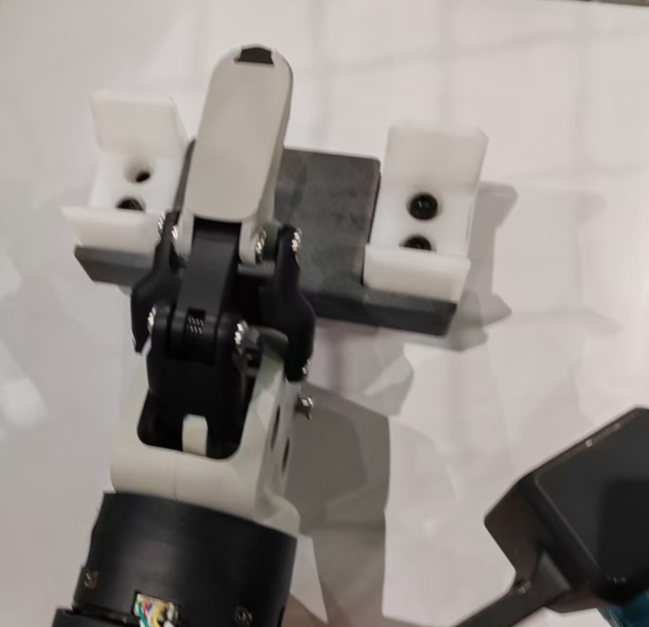
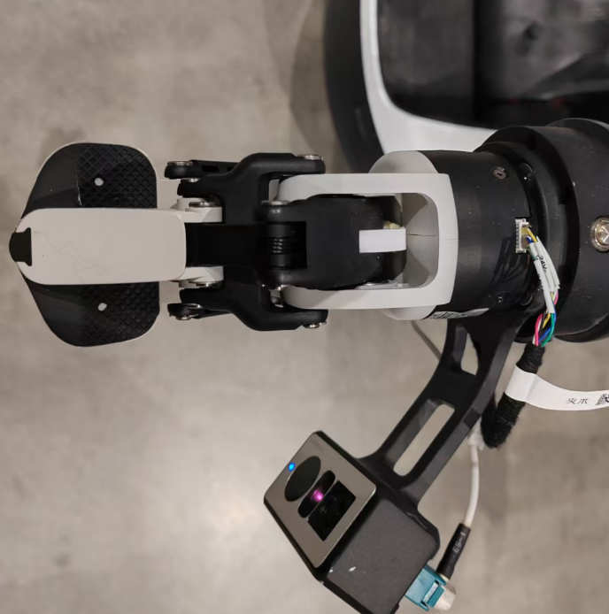
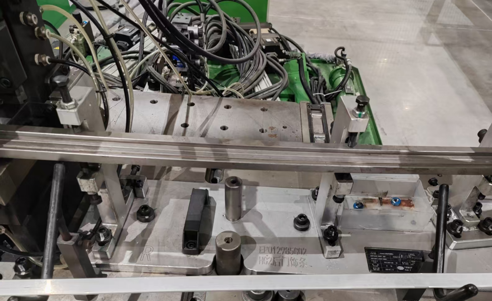
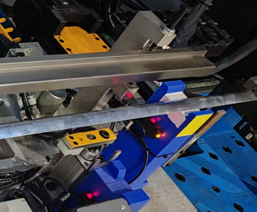
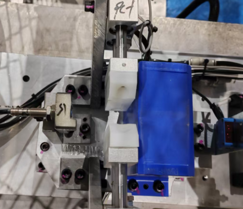
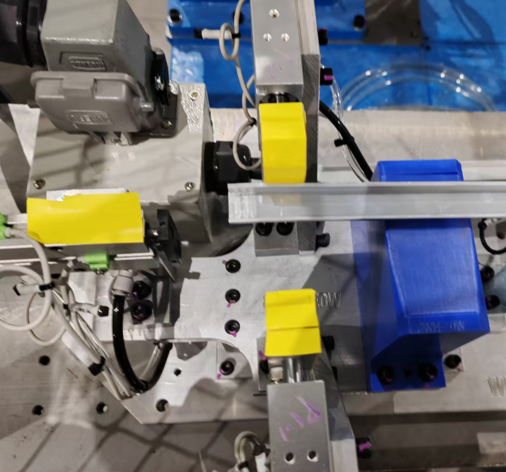
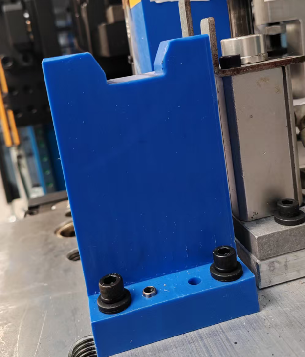
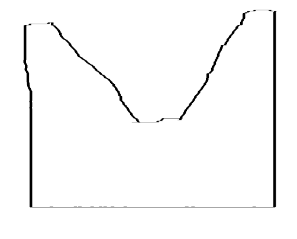

# 通过改工装夹具来提高推理落地

## 先前已解决的例子

这里可以生成一份PPT

### 放弃数采通用性，做定制化夹爪

智元专家建议我们使用原装的夹爪，来提高采集数据的通用性，这样我们采集的数据后续可供他们训练智元的模型使用。
但，原装的夹爪很差，最终我们否定了智元专家的建议，改造了末端夹爪，把双弯曲手指改为单弯曲手指， 提高了数采效率， 也能训练模型和推理。

#### 参考图片

智元G2机器人的默认夹爪，改造前

我们改造后的夹爪

### 增大夹具容差

原有的工装台，是人类上料的， 上料精度要求较高，推理放置的精度很难达到人类放置的精度，因此，修改工装台的放置架，把原来人类放置时的毫米级容差， 放大到厘米级容差，比如把正负1毫米的容差放大到正负40毫米的容差， 然后再在工装台上增加二次精定位机构。 这样一来，就大大提高了推理成功率， 虽然推理的误差依然很大。

#### 参考图片

没有加大容差的过渡架子，改造前

加了大容差的过渡架子

### 增加产品、和工装台的色差

原有的工装台是不锈钢，产品是铝条，都是银色，色差很小。 因此，我们更改工装台的颜色，贴上黄色的绝缘胶布，增大产品和工装的色差。

#### 参考图片

没有贴色差黄条， 汽缸夹爪是银色的，改造前

贴了色差黄条， 汽缸夹爪上面贴了， 和铝条（银白色）看上去很明显

### PPT 内容及排版

以上三部分内容，做成一页PPT，为 图文并茂类型PPT

页面上， 横向排版， 分3个区域，

每个区域内，上面呢， 做左 右 两张图片， 描述改造前后的区别， 图片你可以自己裁剪， 可以裁剪的窄一点

下面呢， 是文字描述， 介绍这一部分的改进

## 正在解决的问题

### 增加光源

计划安装 条状红色可调光源  ，来控制光色环境。

#### 图片生成

生成两张图品，

第一张图片： 一个不锈钢工装上（银色）， 放着一根铝条（银色）， 被头部的白炽灯电光源照着， 有较大的反光

第二张图片： 一个不锈钢工装上（银色），放着一根铝条（银色），被头部的红色条状光源照着， 没有反光，铝条的轮廓被照得很明显

### 更改工装台的结构，提升机械引导性

增大引导槽面

#### 图片参考

当前情况，机械引导槽面比较短。 

根据这个手绘参考图（截面图）， 生成引引导槽， 主要变化是整体变宽， 槽面更长

### 上面2个部分， 也写一页PPT ，类型是 图文并茂 类PPT

页面分为左右两个部分， 分别使用两张生成的图片， 然后下面写一些文字描述，
