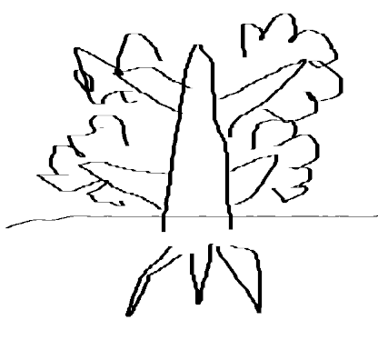

# 总结我部门在人形机器人应用开发的技术路线

这一页 PPT 可以用 树形结构 来制作

树主干是： 人形应用

## 在大脑端的技术掌握

- 我们掌握了 pi 0, pi 0.5 这两个基座VLA模型的 采、训、推 流程
- 掌握了 GROOT N1.7 的采训推
- 掌握了 LingBot 2 的采训推
- 掌握了 ACT ， DP 的采训推
- Genine SIM 仿真

这个树枝， 要位于 左上角，面积要最大， 树叶大小依次为  PI, GR00T, Lingbot, ACT/DP， 仿真
颜色， 这几个树叶， 要以暖色系为主， 各个节点色彩不能完全一样

这个树枝可以粗一点， 树枝枝干上可以标注文字：大脑端探索

## 在硬件本体方面掌握

- 智元 A3,
- 智元 G2
- 智元 X2
- 萝博派对 RPO

这个树枝， 要位于左侧

G2 节点要最大， 然后是 X2 ， A3, 然后是 RP0 。
这4个树叶，要以绿色系为主， 其中 ， G2 X2 A3 这三个树叶节点的颜色要一样， 因为都是智元的，
PRO 节点可以小一点

树枝枝干上标注文字：  本体使用

## 在工业场景方面的掌握

- 轻长扁金属上下料
- 轻长宽塑料上下料
- 轻小扁塑料件装配

这个树枝，要位于右上角
树干上标注， 场景项目

## 在小脑端方面的掌握

- X2/A3舞蹈
- Isaac
- Mojoco

这个树枝， 要位于右下角，地平线以上

树枝上标注，小脑探索

## 树根，地面以下，是数据

叶子节点分别是

- 数采平台
- Lerobot
- FineDance
- 1.3TB/2.4万条

树根主干上标注 数据

## 整体图片示意图

