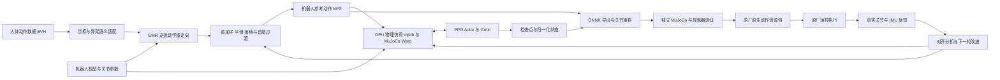
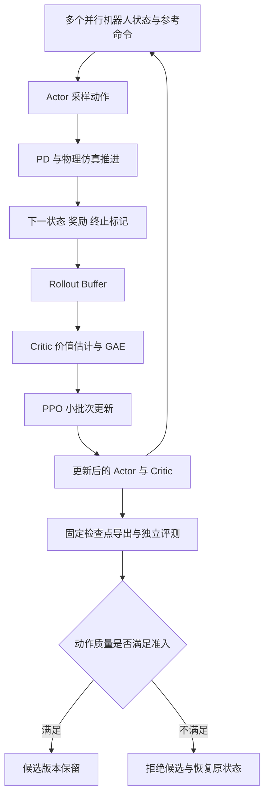
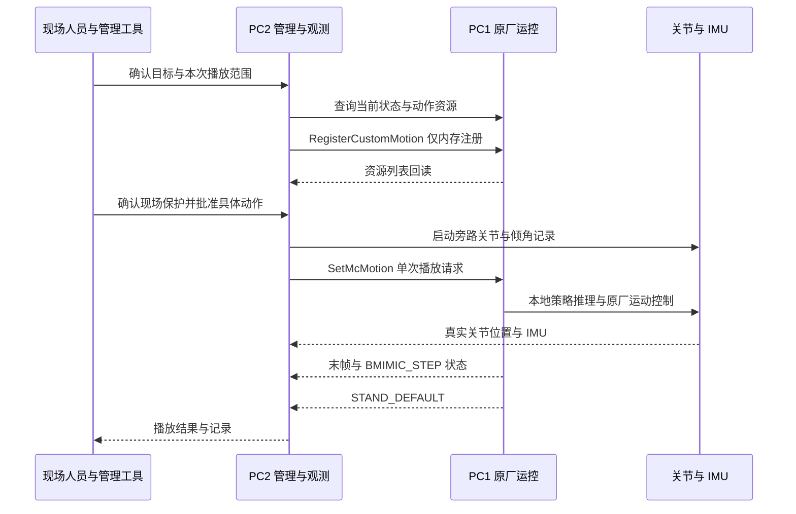

# X2 人形机器人强化学习：技术架构与从 0 到 1 的实现

**面向 NVIDIA 客户参观的技术交流说明**

版本：v1.0 ｜ 证据截至：2026 年 11 月 9 日，UTC+8

阅读方式：第 1—4 节介绍项目与整体架构；第 5—12 节展开工程实现；第 13—17 节用于现场展示、技术问答及后续合作讨论。附录中的源码和记录链接用于项目工作区内追溯，正文可独立阅读。

### 阅读导航

- [项目成果与整体架构](#section-1)
- [技术栈与 NVIDIA 的关系](#section-3)
- [人体动作、重定向与数据契约](#section-5)
- [机器人模型与强化学习输入输出](#section-6)
- [奖励、PPO 与 GPU 并行训练](#section-8)
- [模型导出与分层验证](#section-10)
- [真机部署及执行证据](#section-12)
- [运动基座研究与合作议题](#section-13)
- [现场讲稿与技术问答](#section-16)
- [模型版本、源码与复现附录](#appendix-a)

---

<a id="section-1"></a>

## 1. 项目概览：我们已经做到了什么

我们已经打通一条面向智元灵犀 X2 Ultra 的全身动作学习链路：

**真人动作数据 → 机器人动作重定向 → GPU 物理仿真与强化学习 → 策略导出 → 独立仿真验证 → 原厂运控原生播放 → 真机数据回收。**

当前工作的重点，是将这条链路从“能够训练并部署单支舞蹈”，推进到“拥有自己的多动作运动基座，再用这个基座学习新的舞蹈和全身动作”。

### 1.1 已经验证的成果

| 能力         | 已完成的内容                                                                | 验证依据                               |
| ------------ | --------------------------------------------------------------------------- | -------------------------------------- |
| 动作数据处理 | 解析人体动捕数据，适配 X2 骨架，生成 50 Hz 机器人参考动作                   | 重定向、重采样、首尾站姿和 FK 转换代码 |
| 强化学习训练 | 基于 GPU 并行物理仿真训练全身动作跟踪策略，支持从随机初始化训练及检查点续训 | 训练脚本、任务配置、检查点和实验记录   |
| 部署接口适配 | 将训练内部关节顺序转换成部署顺序，导出 ONNX 并打包原厂原生播放器需要的输出  | 导出代码、元数据和输出等价性检查       |
| 真机执行     | 三支历史专项自训舞蹈通过原厂运控完整播放，并自动返回站立                    | 本次三条原生动作日志和关节记录         |
| 运行证据回收 | 对接动作状态、末帧计数、IMU 倾角与 29 个关节位置                            | 本次两轮监控共 954,438 行记录          |

2026 年 11 月 9 日，本次在吊绳保护、现场急停准备就绪的条件下，三支历史旧版模型分别执行一次：

| 演示动作 | 实际动作时长 | 动作期间最大倾角 | 原生末帧计数 | 结束状态      |
| -------- | -----------: | ---------------: | -----------: | ------------- |
| d2s5     |     47.98 秒 |          25.03° |  2398 / 2398 | STAND_DEFAULT |
| d2s3     |     48.00 秒 |          27.78° |  2398 / 2398 | STAND_DEFAULT |
| d1s2v    |     37.99 秒 |          37.47° |  1898 / 1898 | STAND_DEFAULT |

三段都记录到了真实关节运动，均未触发本次旁路监控的 45°阻尼保护。两轮监控随后自然结束，原始文件已回传并校验哈希。这里的“完整”同时有服务端末帧计数、状态转换和关节反馈支撑，并非只依据接口返回成功。[实机结果与分析][S01]

### 1.2 需要准确区分的三个层次

1. **已完成：专项动作从训练到真机的工程闭环。** 本次三支舞各有自己的专项模型与参考动作。
2. **正在研究：自己的多动作运动基座及新舞微调能力。** 已有训练和评测实现，但旧技能保持、长时朝向、跳跃与落地质量还未同时达标。
3. **尚未宣称完成：任意新舞零样本泛化、全面达到原厂观感、无吊绳长期稳定执行。**

因此，现场准确的介绍是：

> 我们已经能够把人体动作转成 X2 的参考动作，在 GPU 物理仿真中训练自己的动作跟踪策略，并通过原厂运控在真实机器人上执行。下一阶段正在把专项能力扩展成可复用的多动作运动基座。

<a id="section-2"></a>

## 2. 系统整体技术架构

### 2.1 从数据到机器人的全链路



这条链路分成两个不同时间尺度：训练阶段在仿真中进行大量试错；部署阶段使用已经训练好的策略做前向推理，不在舞蹈执行过程中在线更新网络参数。

### 2.2 训练平面、执行平面与观测平面

| 平面           | 主要职责                               | 主要组件                                            | 产物或反馈                             |
| -------------- | -------------------------------------- | --------------------------------------------------- | -------------------------------------- |
| 数据与训练平面 | 生成参考、模拟物理、采集样本、优化策略 | GMR、MuJoCo、MuJoCo Warp、mjlab、PyTorch、RSL RL    | NPZ、检查点、训练配置、日志            |
| 验证与发布平面 | 核对模型接口、物理闭环及动作质量       | ONNX Runtime、独立 MuJoCo、自有仿真控制器、评分脚本 | 固定版本 ONNX、质量报告、发布判定      |
| 真机执行平面   | 从策略计算动作并执行状态切换           | 原厂运动控制系统、原生动作资源接口                  | BMIMIC、BMIMIC_STEP、站立状态          |
| 观测与分析平面 | 记录动作是否真实执行、定位偏差         | ROS 2 关节与 IMU 订阅、原厂日志、离线分析           | 实际运动记录、倾角、动作末帧和对齐结果 |

**GPU 训练机不通过网络逐周期遥控机器人的关节。** 网络主要承担文件传输、管理请求和记录回收；舞蹈策略由机器人本地的原厂运动控制链路执行。

<a id="section-3"></a>

## 3. 技术选型，以及与 NVIDIA 技术栈的关系

### 3.1 本项目实际采用的技术栈

| 层次           | 当前采用或已验证的技术                     | 在本项目中的具体角色                     |
| -------------- | ------------------------------------------ | ---------------------------------------- |
| 人体数据处理   | Python、NumPy、SciPy                       | BVH 解析、旋转处理、重采样与速度计算     |
| 动作重定向     | GMR 及机器人 IK 适配                       | 把人体动作映射为 X2 的关节和根部轨迹     |
| 机器人动力学   | MuJoCo / MJCF                              | 机器人惯性、关节、执行器、碰撞和接触模型 |
| GPU 物理仿真   | MuJoCo Warp、NVIDIA Warp                   | 批量推进虚拟机器人的物理状态             |
| 任务框架       | mjlab                                      | 管理观测、动作、命令、奖励、重置和终止   |
| 学习算法       | RSL RL 的 PPO，PyTorch / CUDA              | 优势估计、Actor 与 Critic 优化           |
| 模型交换       | ONNX                                       | 固化策略、归一化、关节映射及参考动作输出 |
| 离线推理检查   | ONNX Runtime                               | 检查导出前后的数值和接口一致性           |
| 真机接口       | ROS 2、原厂原生运控服务                    | 注册资源、播放动作、读取状态与关节数据   |
| 第二套训练对照 | Isaac Lab / whole_body_tracking 的 X2 适配 | 用另一套训练实现进行对照诊断             |

mjlab 的官方定位是将 Isaac Lab 风格的 manager-based API 与 MuJoCo Warp 结合。它不等于“本项目的每次训练都在 Isaac Sim 中运行”。[mjlab 官方说明](https://github.com/mujocolab/mjlab/blob/main/README.md)

MuJoCo Warp 面向 NVIDIA 硬件和并行物理仿真；NVIDIA Warp 提供 GPU 计算内核与相关仿真能力。本项目主要利用这条路径提高物理样本生成能力，再用 PyTorch/CUDA 完成策略学习。[MuJoCo Warp 官方说明](https://github.com/google-deepmind/mujoco_warp)、[NVIDIA Warp 官方说明](https://github.com/NVIDIA/warp)

### 3.2 NVIDIA GPU 在这里解决什么问题

一次动作试验需要持续计算接触、重力、惯性、关节响应和策略输出。单个机器人顺序试错，样本获取成本很高。

GPU 并行训练让多个虚拟机器人同时在不同状态下练习：有的学习起步，有的学习中段，有的学习转身或落地；策略每轮从这些轨迹中提取更新信号。

我们已有脚本使用 4096 个并行环境的配置，多动作历史实验也使用过 2048 个环境；为了定位问题，受控实验会使用更小的并行规模，例如 96 个环境。**这些是不同实验配置，不能把某一个并行数作为所有版本的固定参数。**[训练入口][S02]、[历史基座训练脚本][S16]

GPU 的价值同时体现在样本生成和网络更新；但并行数不能直接等同最终动作质量。接触复杂度、采样分布、参考动作可行性和奖励设计都会影响学习结果。

### 3.3 Isaac Lab、TensorRT 与其他 NVIDIA 产品的表述边界

| 技术                      | 当前项目状态                   | 对外合适的表述                                                 |
| ------------------------- | ------------------------------ | -------------------------------------------------------------- |
| NVIDIA GPU / CUDA         | 已用于训练                     | 用于并行物理样本与策略优化                                     |
| NVIDIA Warp / MuJoCo Warp | 训练主线所用组件               | GPU 物理仿真的实际组成部分                                     |
| Isaac Lab                 | 做过独立训练适配与对照         | 已具备对照工程，当前演示模型来自 mjlab 主线                    |
| TensorRT                  | 尚无本项目部署验收证据         | 可作为后续推理优化议题，不宣称已经采用                         |
| GR00T / VLA / 语言模型    | 不属于本次演示策略的输入与实现 | 本项目当前聚焦全身运动控制，而非语言或视觉动作模型             |
| 多卡分布式训练            | 尚无本项目完整验收证据         | 已有任务指定单卡运行的脚本，不把分卡跑实验称为已完成分布式训练 |

Isaac Lab 官方框架的能力和版本会演进；本项目历史对照版本与当前主线应分开管理，不把官方最新功能直接计作项目已实现功能。[Isaac Lab 官方说明](https://github.com/isaac-sim/IsaacLab)

### 3.4 计算与部署资源如何分工

| 位置                | 工程中的角色                           | 需要区分的事实                                                                 |
| ------------------- | -------------------------------------- | ------------------------------------------------------------------------------ |
| NVIDIA GPU 训练资源 | 并行仿真、PPO 更新和部分数据处理       | 历史使用过 RTX 4090、A100 等资源；不表示这些历史资源现在都仍在线               |
| 开发与评测工作站    | 源码、数据核查、独立仿真、模型导出检查 | 本地回放与 GPU 训练的依赖版本需要分别记录                                      |
| X2 PC1 原厂运控板   | 加载原生动作资源并执行本地运动控制     | 已验证的是原厂 ONNX 资源执行链，没有将其内部推理后端表述为已完成 TensorRT 优化 |
| X2 PC2 二开与通信侧 | 接收管理连接、运行接口客户端和旁路监控 | 管理端与训练端并不等于实际执行策略的运控端                                     |

训练资源、机器人计算板和模型推理后端是三个不同概念，不能仅因为系统中存在 NVIDIA 硬件，就宣称所有执行环节都在 GPU 上运行。

<a id="section-4"></a>

## 4. “从 0 到 1”实际包含哪些工作

这里的“从 0 到 1”包含两个含义：一是从人体数据到真实机器人执行的工程闭环；二是在明确的专项任务上，从随机初始化开始训练策略。它不意味着重新发明物理引擎、PPO 算法或机器人底层固件。

| 阶段        | 要解决的问题                       | 我们形成的工程能力                       | 关键交付物                   |
| ----------- | ---------------------------------- | ---------------------------------------- | ---------------------------- |
| 0. 基线建立 | 官方机器人模型和仿真是否能正常运行 | 先复现官方示例，建立已知可运行的参照     | 模型、配置、官方策略对照记录 |
| 1. 数据适配 | 人体与机器人骨架不一致             | 人体骨骼、坐标、单位及关节语义转换       | 重定向脚本和机器人参考轨迹   |
| 2. 数据质量 | IK 能解出来，是否就能真实执行      | 检查限位、连续性、速度、脚底与首尾过渡   | 清洗后的参考与诊断结果       |
| 3. 任务适配 | 框架中的机器人如何与部署一致       | 观测、动作、模型、PD、关节名和传感器适配 | X2 训练任务                  |
| 4. 策略训练 | 如何在物理约束下跟踪动作           | GPU 并行采样、PPO、存档与实验记录        | Actor / Critic 检查点        |
| 5. 部署转换 | 训练格式如何被机器人正确读取       | ONNX 导出、顺序重排、资源格式转换        | 原厂原生动作包               |
| 6. 分层验证 | 模型能运行，动作是否真的正确       | 独立仿真、控制器验证、扰动测试和逐帧对比 | 可追溯的评估报告             |
| 7. 真机闭环 | 是否真实执行、是否完整结束         | 原生播放、状态回读、关节监控与记录回收   | 实机动作及运行证据           |

我们实现与集成的核心，是机器人适配、数据处理、训练任务、部署契约、诊断工具和验证流程；PPO、张量计算和物理引擎复用开源组件，真机底层执行沿用机器人厂商提供的运控系统。

<a id="section-5"></a>

## 5. 动作数据：怎样把真人舞蹈变成机器人的参考

### 5.1 输入不是电机指令

输入数据描述人体随时间变化的动作，例如骨骼层级、局部关节旋转、根部平移与采样时间。项目使用过 LAFAN1 和 BONES-SEED/SOMA 格式相关处理链。

机器人与人体在腿长、肩宽、关节自由度、安装姿态和限位上都不同，因此不能把人体关节角直接复制到电机。

### 5.2 骨架和坐标语义适配

重定向之前，需要明确：

- 原始数据的长度单位与机器人模型的长度单位；
- 向上轴、前向方向、根部坐标和左右侧定义；
- 四元数分量顺序；
- 人体骨骼与机器人 link / joint 的对应关系；
- 每个关节的零位与可动范围。

例如，项目中的 SOMA 解析器针对该数据格式处理 120 fps、Y-up 和厘米单位，并转换到后续重定向链需要的表示；不能把这一约定直接套用到所有 BVH。[SOMA 适配实现][S03]

X2 的前臂零位与被借鉴的 G1 IK 配置存在语义差异。我们在重定向适配中处理了姿态偏置，并调整腕部链末端的名称映射。这里不是简单改机器人名称，而是校正目标姿态的几何含义。[X2 重定向实现][S04]

### 5.3 逆运动学重定向

逆运动学的目标，是找到一组机器人关节角，让指定身体部位的位置和姿态尽量贴近人体目标，同时满足机器人的运动学约束。

可以用下面的示意目标理解：

$$
\min_q\;\sum_i w_i^p\|p_i^{robot}(q)-\widetilde p_i^{human}\|^2
+\sum_i w_i^R d_R(R_i^{robot}(q),\widetilde R_i^{human})^2
$$

其中，目标带有适合机器人比例的缩放与姿态偏置。该公式用于说明 IK 的目标构成；实际求解分阶段和权重由 GMR 及 X2 适配配置决定，不能把它当成已实现的全部动态约束。

**IK 求解成功只证明运动学上找到了解，不证明动作已经满足动态平衡、接触力或执行器带宽。** 这些问题要继续交给数据检查、物理仿真和策略训练处理。

### 5.4 从原始轨迹到 50 Hz 参考

项目重定向流程包含：

1. 截取目标动作片段。
2. 逐帧进行人体到 X2 的重定向。
3. 根据脚底碰撞几何进行地面高度处理。
4. 将原始轨迹重采样为 50 Hz；旋转采用球面插值，避免直接线性插值四元数。
5. 对位置和关节轨迹做平滑处理。
6. 加入默认站姿到舞蹈的过渡，以及结束回站姿和保持段。
7. 按时间间隔计算关节速度、根部线速度与角速度。

现有 LAFAN 路径中可配置前导、尾段和保持时间。三段演示的约 48 秒、48 秒、38 秒是打包后完整资源的量级，不能只用原始舞蹈截取长度解释播放时长。[重定向主流程][S04]

### 5.5 训练数据契约

参考数据转换为训练任务可读取的 NPZ。常见字段如下：

| 字段               | 典型形状         | 语义                   | 训练数据中的单位或约定 |
| ------------------ | ---------------- | ---------------------- | ---------------------- |
| `joint_pos`      | `[T, 29]`      | 受控关节的参考位置     | rad                    |
| `joint_vel`      | `[T, 29]`      | 相同顺序的参考关节速度 | rad/s                  |
| `body_pos_w`     | `[T, B, 3]`    | 世界坐标中的身体位置   | m                      |
| `body_quat_w`    | `[T, B, 4]`    | 世界坐标中的身体姿态   | 归一化四元数，wxyz     |
| `body_lin_vel_w` | `[T, B, 3]`    | 世界坐标中的身体线速度 | m/s                    |
| `body_ang_vel_w` | `[T, B, 3]`    | 世界坐标中的身体角速度 | rad/s                  |
| `fps`            | 标量或单元素数组 | 轨迹采样频率           | Hz                     |

`T` 是帧数，`B` 随文件用途变化：原始根部参考、完整 FK 训练文件和导出的跟踪 body 子集，不一定拥有相同的 body 维度。读取前必须绑定对应的关节名、body 名和数据阶段。

`ref_to_npz.py` 使用 X2 模型做正运动学，将参考关节角和根状态转换成训练需要的身体状态；它还对超过硬限位的参考位置进行裁剪，并将对应帧的相关关节速度置零。[FK 与训练格式转换][S05]

裁剪可能改变动作形态和速度连续性，因此“已裁到限位内”仍不是数据质量验收的终点。

<a id="section-6"></a>

## 6. 机器人模型与训练—部署一致性

### 6.1 受控对象

本项目面向 X2 Ultra，模型中有头部关节，但当前策略控制的是腿、腰和双臂共 **29 个关节**，头部两个关节不纳入这套 RL 动作向量。

机器人适配需要同时绑定：关节名称、顺序、默认姿态、增益、力矩范围、惯性参数、碰撞几何和 IMU 对应位置。这些参数从模型与配置读取，不靠人工猜测关节编号。[机器人常量与模型适配][S06]

### 6.2 三种顺序不能混为一谈

项目需要区分：

- MuJoCo / mjlab 内部的自然关节顺序；
- 策略部署配置中的 `seq` 顺序；
- 硬件接口或关节消息自身的组织方式。

即使三者都包含 29 个元素，直接按数组下标互传也可能驱动错误的关节。我们采用名称映射，并将策略输入、动作输出、参考位置和参考速度的重排一起固化到导出图中。

### 6.3 参考锚点与 IMU 不一定是同一个 link

训练动作参考使用 `torso_link` 作为配置中的 anchor，跟踪 body 列表包含 14 个身体部位。但部署观测中的重力投影和角速度，需要按已经验证的 IMU 坐标语义构造。

例如，官方仿真中相关部署观测对应 `imu_0` 的状态，不能因为 ROS topic 名带有 `torso`，就直接把任意躯干 link 的姿态当作同一个量。[模型传感器适配][S06]、[部署观测构造][S07]

<a id="section-7"></a>

## 7. 强化学习：策略到底看什么、输出什么

### 7.1 策略是闭环动作跟踪器

策略既看参考动作，也看机器人的实际状态，然后计算下一周期的关节位置目标。参考负责说明“想做什么”，状态反馈用于判断“现在实际做到了哪里”。

因此，参考轨迹本身不是最终控制指令；训练后的策略负责在物理约束和状态偏差存在时跟踪它。

### 7.2 151 维 Actor 观测

部署观测按照已经固定的顺序拼接：

$$
o_t=[q_t^{ref},\dot q_t^{ref},g_t^{proj},0.25\omega_t,
q_t-q^{default},0.05\dot q_t,a_{t-1}]
$$

| 索引，左闭右开 | 维度 | 内容                   | 作用                     |
| -------------- | ---: | ---------------------- | ------------------------ |
| `[0, 29)`    |   29 | 参考关节位置           | 当前想跟踪的姿态         |
| `[29, 58)`   |   29 | 参考关节速度           | 当前动作的变化趋势       |
| `[58, 61)`   |    3 | 重力投影               | 机身倾斜信息             |
| `[61, 64)`   |    3 | 角速度乘 0.25          | 机身旋转状态             |
| `[64, 93)`   |   29 | 实际关节位置减默认姿态 | 当前关节状态             |
| `[93, 122)`  |   29 | 实际关节速度乘 0.05    | 关节运动状态             |
| `[122, 151)` |   29 | 上一周期动作           | 动作连续性与动态响应信息 |

合计：`29 + 29 + 3 + 3 + 29 + 29 + 29 = 151`。

这套 Actor 没有视觉图像或语言指令输入，也没有直接加入绝对世界航向误差。不能把当前策略描述成已经具备视觉理解、语言理解或任意航向纠偏的通用模型。[观测配置][S08]、[观测重排实现][S09]

### 7.3 Actor、Critic 与训练时的探索

当前审计配置采用 MLP，隐藏层为 **512 → 256 → 128**，激活函数为 ELU。Actor 输出 29 维动作；Critic 在训练中估计状态价值，为 PPO 提供学习信号。

训练时可使用高斯动作分布进行探索；部署时导出策略的确定性动作路径。Critic 不属于机器人运行时必须执行的网络。

Actor 输入的归一化统计是模型状态的一部分。随机初始化训练时需要学习合适的输入统计；部署必须使用与该检查点对应的统计。把另一支舞的统计直接冻结后用于新数据，或者只拷 MLP 权重而遗漏归一化，都可能改变策略行为。[训练入口与归一化控制][S10]

作为规模参考，`151 → 512 → 256 → 128 → 29` 的全连接均值网络包含约 **24.6 万个权重与偏置参数**，不含归一化和动作分布状态。这是结构估算，不是推理耗时测量。完整部署 ONNX 还包含参考动作表，所以文件大小不等同网络参数大小。

Critic 可使用训练中的附加仿真信息；近期受控实验记录的 Critic 输入宽度是 289。该数值属于对应实验配置，不能据此补写所有历史模型的 Critic 结构。[受控实验配置][S11]

### 7.4 29 维动作与 PD 控制

Actor 输出 `a_t` 之后，当前部署契约把它转换为：

$$
q_t^{des}=q^{default}+0.25a_t
$$

`a_t` 是策略动作，不是可直接解释为电机力矩的数组。

独立 MuJoCo 验证中的显式 PD 形式为：

$$
\tau_t=\operatorname{clip}\left(K_p(q_t^{des}-q_t)-K_d\dot q_t,\tau_{min},\tau_{max}\right)
$$

实际真机执行由原厂运控完成，本项目不把上述仿真实现当作已完整公开的原厂控制器内部实现。[动作缩放来源][S06]、[独立仿真 PD 实现][S07]

### 7.5 三类时钟必须区分

| 时钟             | 本项目中的例子                                                | 不能混淆的地方                                          |
| ---------------- | ------------------------------------------------------------- | ------------------------------------------------------- |
| 策略周期         | 20 ms，即 50 Hz                                               | 决定何时更新策略动作和参考阶段                          |
| 物理积分步长     | 历史训练存在 5 ms × 4；独立验证及执行对齐实验采用 1 ms × 20 | 同为 50 Hz 策略，不意味着积分器、接触与 PD 行为完全一致 |
| 真机底层任务周期 | 由原厂运控、驱动及总线配置决定                                | 不能用仿真 1 kHz 或旁路记录速率替代真实总线频率         |

执行对齐实验明确建立了独立的 1 ms、Euler、显式 PD 配置，并保留原配置用于对照；它是对齐工程，不是宣布所有历史训练已经使用同一物理执行方式。[执行对齐配置][S12]

### 7.6 为什么不直接把参考角度当作策略输出

参考角度描述希望呈现的动作，而 PD 目标还承担驱动实际身体加速、抵抗重力和处理接触的作用。相同参考姿态，在不同实际速度、倾斜或接触状态下，可能需要不同的策略输出。

因此，普通动作跟踪 RL 用参考来定义任务与奖励，再让策略通过物理交互学习控制行为。它不同于直接监督拟合“参考角度等于电机目标”。历史教师辅助实验则模仿另一策略的动作输出，也需要单独说明教师与数据来源。

<a id="section-8"></a>

## 8. 奖励、约束与动作质量

### 8.1 奖励由多个目标共同构成

策略要同时完成姿态跟踪、身体运动、动作平滑和约束遵守。仅有“关节角像参考”不足以保证舞蹈有节奏、转身正确、跳跃真实离地或落地平稳。

以关节位置跟踪为例，已有实现为：

$$
r_q=\exp\left(-\frac{\operatorname{mean}((q-q^{ref})^2)}{\sigma_q^2}\right)
$$

尺度 `sigma` 决定误差多大时奖励明显下降。容差过紧时，大误差区域可能区分信号很弱；权重更大也不等于一定更容易学到动作。

### 8.2 一个已经记录的配置实例

下表来自近期受控研究实验，目的是说明实现粒度，**不是今天三支历史演示模型的统一训练配方，也不是已经发布的最佳参数**。

| 奖励或惩罚           | 权重示例 | 关键尺度或参数                      |
| -------------------- | -------: | ----------------------------------- |
| 全局 anchor 位置跟踪 |      0.5 | std 0.3 m                           |
| 全局 anchor 姿态跟踪 |      0.5 | std 0.4，具体误差定义由奖励函数决定 |
| 相对身体位置跟踪     |      1.0 | std 0.3 m                           |
| 身体姿态跟踪         |      1.0 | std 0.4                             |
| 身体线速度跟踪       |      1.0 | std 1.0                             |
| 身体角速度跟踪       |      1.0 | std 3.14                            |
| 关节位置跟踪         |      2.0 | std 0.1 rad                         |
| anchor 高度跟踪      |      2.0 | std 0.08 m                          |
| 双脚踝高度跟踪       |      3.0 | std 0.1 m                           |
| 动作变化惩罚         |    −0.1 | 相邻动作变化                        |
| 实际关节限位惩罚     |   −10.0 | 由模型中的关节限位计算              |
| PD 目标超限惩罚      |    −5.0 | 已有 margin 0.5 rad 的平方惩罚      |

表中尺度应按具体奖励函数理解，不能把所有 `std` 都当成同一物理量。原始配置和函数分别可查。[配置快照][S11]、[自定义奖励函数][S08]

### 8.3 为什么需要同时检查实际关节和 PD 目标

实际关节可能仍在机械限位内，但策略已经输出远超范围的目标，试图通过大的 PD 误差获取驱动力。这会造成目标越界、饱和或启动冲击。

因此评估同时保留：实际关节误差、目标超限、力矩饱和和动作平滑指标。不能只看最终关节位置没有越界。

### 8.4 终止规则、随机化与参考质量共同影响学习

训练任务可以使用姿态、偏航、时间和片段末尾等终止条件，具体集合按实验配置冻结。环境随机化包括摩擦、质心、编码器偏置、观测噪声，以及任务配置中的外部扰动。

这些机制用于增加状态覆盖和提高适应性，但不能替代完整动作验证。大量短片段完成训练，也不自动意味着机器人能够从默认站姿连续执行整支舞。

<a id="section-9"></a>

## 9. GPU 并行 PPO 训练怎样工作

### 9.1 一轮训练的数据流



该图表达训练与质量管理的逻辑，不代表所有历史长训脚本都已经集成同一种自动回退控制器。

其中的回退需要明确对象：模型、归一化、优化器与随机状态的恢复，不自动等于仿真世界状态也已恢复。是否需要继续同一物理轨迹，应另行保存并核验仿真状态。

### 9.2 采样记录包含哪些信息

PPO 训练至少需要保留观测、采样动作、旧策略动作概率、奖励、终止与价值估计。为了诊断机器人问题，工程记录还会增加：动作命令编号、参考局部帧、片段标识、上一动作、关节状态、物理状态及奖励分量。

只保存一条总奖励曲线，无法判断具体哪段舞、哪种状态或哪个奖励项导致退步。

### 9.3 PPO 的更新目标

使用优势估计衡量某个采样动作相对于当前价值估计的好坏。GAE 的基本形式是：

$$
\delta_t=r_t+\gamma(1-d_t)V(s_{t+1})-V(s_t)
$$

$$
\widehat A_t=\delta_t+\gamma\lambda(1-d_t)\widehat A_{t+1}
$$

其中 `d_t` 是与当前 rollout 处理一致的终止标记；时间上限的 bootstrap 在存储中的处理方式也必须一并核对。

PPO 的裁剪代理目标可以写为：

$$
L_{clip}=\mathbb E_t\left[\min\left(\rho_t\widehat A_t,
\operatorname{clip}(\rho_t,1-\epsilon,1+\epsilon)\widehat A_t\right)\right]
$$

$$
\rho_t=\frac{\pi_\theta(a_t|o_t)}{\pi_{old}(a_t|o_t)}
$$

Critic 使用价值损失学习，策略分布还可有熵正则。工程实现调用 RSL RL 的 PPO；机器人相关工作主要在任务、采样、奖励、验证和部署适配层。

### 9.4 一个可复核的受控实验规模

近期有界对照采用：96 个并行环境，每个环境采样 512 个策略步，总计 **49,152 条真实仿真转移**。策略步长 20 ms，物理步长 1 ms，对应 **983,040 个“环境 × 物理子步”**。

该批数据供两个候选分支进行对照；每支分支执行一次 PPO 更新，配置为 5 个 epoch、4 个 mini-batch，即每支 20 次 Adam 步。物理采样只生成一次，不应把两个分支重复使用数据写成新生成了两批样本。

这个配置用于诊断目标差异，不代表一轮就能训练出新的舞蹈。其价值是让两种方案从相同 Actor、Critic、优化器和 RNG 状态出发，使用相同物理数据与小批次顺序，并分别计算不同奖励下的回报与优势。[受控训练实现][S13]

### 9.5 吞吐、学习效率和动作质量要分别报告

后续性能评估应分开统计：物理子步吞吐、策略采样吞吐、PPO 更新耗时、检查点与审计开销、达到约定质量所需的总时间，以及显存占用。

一个方案可能采样更快，却需要更多样本才能达到相同动作质量；也可能总奖励上升，但某支旧舞退步。因此不能只按训练迭代数或平均奖励评定最终结果。

### 9.6 GPU 物理仿真不等于直接对物理引擎求导

本项目通过仿真生成交互轨迹，再依据动作概率和优势估计更新策略参数。当前 PPO 路线不以“把梯度穿过所有接触与物理积分步骤”作为训练前提。Warp 的计算能力与项目是否实现可微物理端到端优化，需要分别说明；后者没有被计作本项目已完成能力。

<a id="section-10"></a>

## 10. 模型导出与原厂动作资源打包

### 10.1 为什么需要单独的导出层

训练网络理解的是训练内部顺序；机器人播放器需要部署顺序。导出层同时承担接口适配和模型固化：

1. 将 151 维部署观测中的关节相关段重排为 mjlab 顺序。
2. 调用包含对应归一化状态的 Actor。
3. 将 29 维动作重排回部署顺序。
4. 按时间索引输出参考关节和身体状态。
5. 写入关节名、默认姿态、动作缩放、增益和参考长度等元数据。

这使映射关系随模型一起发布，而不是依赖每台机器手工维护一套数组。

### 10.2 ONNX 的主要输入与输出

| 类别 | 名称                                    | 本项目接口中的形状或语义                          |
| ---- | --------------------------------------- | ------------------------------------------------- |
| 输入 | `obs`                                 | float32，`[1, 151]`                             |
| 输入 | `time_step`                           | float32，`[1, 1]`，图中转成索引并按参考长度限制 |
| 输出 | `actions`                             | `[1, 29]`，策略动作                             |
| 输出 | `joint_pos` / `joint_vel`           | 当前索引对应的参考关节位置与速度                  |
| 输出 | `body_pos_w` / `body_quat_w`        | 参考 body 的世界位置与 wxyz 姿态                  |
| 输出 | `body_lin_vel_w` / `body_ang_vel_w` | 参考 body 的速度                                  |

`time_step` 在该导出实现中负责选择参考表，Actor 的动作计算仍取决于 `obs`。不能把它描述为直接送入 MLP 的额外第 152 维观测。[DeployOnnxModel][S09]

### 10.3 原厂原生格式的五项附加输出

打包器在原有输出之外添加：

| 输出                  | 作用                 |
| --------------------- | -------------------- |
| `motion_phase`      | 动作开始、结束索引   |
| `default_joint_pos` | 默认关节姿态         |
| `action_scale`      | 动作到关节目标的缩放 |
| `joint_stiffness`   | 各关节增益参数       |
| `joint_damping`     | 各关节阻尼参数       |

原有 Actor 和参考输出应保持不变。现有打包脚本对多个输入和时间点核对原输出逐元素一致，并核对新增常量与元数据一致。[原生格式打包器][S14]

### 10.4 发布物与继续训练检查点的区别

- **检查点 `.pt`**：用于继续训练或审计，应包含 Actor、Critic、归一化及优化器状态；受控实验还保存 Torch CPU/CUDA、NumPy 和 Python RNG 状态。
- **完整部署 ONNX**：用于机器人执行，包含策略、参考表和原生资源接口所需输出。
- **仅动作输出的 ONNX**：可用于固定外部参考下的离线评估；缺少完整原生契约时，不能直接当作真机动作包。

本次演示使用的是已经验证过的完整原生资源包，文件约 2.82—3.30 MB，策略和参考动作共同构成资源。

<a id="section-11"></a>

## 11. Sim-to-Sim 与 Sim-to-Real 的验证方法

### 11.1 分层验证，而不是一次成功包办所有结论

| 层次         | 需要回答的问题               | 典型检查                                  |
| ------------ | ---------------------------- | ----------------------------------------- |
| 数据层       | 参考格式和几何是否正确       | 名称、顺序、单位、时间轴、FK、限位与脚底  |
| 模型层       | 导出是否保留原策略功能       | Torch / ONNX 动作差异、归一化、输出元数据 |
| 物理层       | 策略在闭环中能否跟踪         | 完整默认起步、方向、倾斜、离地、落地      |
| 控制器层     | 播放器是否按正确节拍解释模型 | 参考时序、上一动作、PD、推理频率与看门狗  |
| 真机层       | 动作是否被真实执行并正常结束 | 状态转换、末帧、真实关节运动、IMU、回站立 |
| 质量与泛化层 | 动作是否好看、稳定、可复用   | 同帧对照、重复执行、扰动、独立未见动作    |

导出检查脚本会比较原生策略与 ONNX 的动作结果，但使用的是专门的评测配置，其终止设置不能代表所有训练或真机配置。因此，数值接口检查通过不能代替完整动作和真机放行。[导出核验实现][S22]

### 11.2 要比较同一条参考、同一帧和同一个物理量

比较模型之前，首先固定参考动作、起步状态、时钟及停止口径。不能一支模型对自己的参考打分，另一支模型对不同参考打分，再拿两个误差直接排名。

独立仿真记录中存在“执行命令 k 后的状态，对齐参考 k+1”的合同；它必须按记录方式复核。原始状态、实际关节、参考和完整 qpos 都要保留，避免渲染或对齐过程中无意改变朝向、时间或高度。[独立仿真记录实现][S07]

### 11.3 脚踝 link 高度不等于脚底真实离地

机器人脚踝 link 的原点与碰撞脚底之间有几何偏移。评估跳跃时，需要区分脚踝 link 高度、根部高度，以及碰撞几何最低点到地面的净空。

当前研究的主要离地指标使用碰撞脚底净空；旧诊断脚本中的脚踝高度要单独标注。把两个口径混用，会制造“跳高变好了”的假象。

### 11.4 典型扰动矩阵

现有测试脚本包含 10 种情形，每种 3 个随机种子：名义条件、不同推力、摩擦变化、质量变化、延迟、观测噪声及组合扰动，共 30 个案例。[扰动测试脚本][S15]

“10 情形 × 3 seed”不能写成“30 个独立随机种子”；某个旧模型的历史通过，也不能自动沿用给新检查点。测试还要固定推力施加位置、持续时间、参考和起步方式。

### 11.5 从真实问题中形成的工程经验

**例一：策略节拍。** 自有 C++ 路径曾出现实际推理约 47.2 Hz、目标为 50 Hz 的偏差；后续改为固定节拍推进。当前真机演示采用原厂原生播放器，减少自定义状态切换和下发链路带来的变量。[C++ 节拍实现][S18]

**例二：参考动作的等效 IK 解。** 手臂可能出现运动学上可行、但贴近限位且变化过快的解。策略误差并不总是来自训练不足，重定向本身也需要连续性与执行能力检查。

**例三：保护旧技能的奖励方向。** 如果把表现一般的旧轨迹高度作为双向平方误差目标，机器人高于旧高度也会被惩罚。近期已验证改为部分空中状态的下限保护，但完整动作质量仍未全部通过，所以该研究候选没有发布。[近期研究结果][S17]

这些例子说明，我们改进的是数据、学习、执行与验收之间的共同契约，而不只是调一个奖励系数。

<a id="section-12"></a>

## 12. 真机部署：为什么选择原厂运控原生播放

### 12.1 当前实际执行链



图中重点是职责分离：PC2 承担管理与旁路观测，PC1 原厂运控执行动作；训练机和参观用电脑不承担实时关节控制环。

### 12.2 原生接口契约

已经验证的资源调用包含：

| 接口                     | 使用方式                                                           |
| ------------------------ | ------------------------------------------------------------------ |
| `GetMcAction`          | 读取原厂当前动作状态                                               |
| `GetMcMotions`         | 回读已注册动作资源                                                 |
| `RegisterCustomMotion` | 指定动作 tag、MIMIC 类型和模型路径；本次 `write_to_disk=False`   |
| `SetMcMotion`          | 本次按指定 tag 单次请求，`interrupt=False`、`play_timestamp=0` |

状态序列为：

```text
STAND_DEFAULT
    → BMIMIC
    → 达到动作末帧
    → BMIMIC_STEP
    → STAND_DEFAULT
```

资源注册不等于开始动作；接口接受不等于动作已经完整执行。本次每支舞都进一步核对了服务端末计数和真实关节数据。[本次部署与执行记录][S01]

### 12.3 为什么管理网络延迟不应拖慢舞蹈

本次通过 Wi-Fi 进入机器人管理链路。开始播放后，参考表和策略资源都在机器人侧，原厂运控按本地时钟执行。

因此，正常播放不是由参观电脑每 20 ms 通过 Wi-Fi 发送一组关节角。管理网络依然影响可观测性和指令确认，但不应把它与机器人本地控制周期混为一谈。

### 12.4 现场保护与记录

本次使用已经存在的旁路监控：订阅 29 个关节与 IMU，倾角超过 45°时请求原厂 DD 阻尼；因为阻尼会让关节变软，执行条件包含吊绳和现场急停看护。[旁路监控实现][S19]

这里的 45°是本次监控配置，不是整套机器人的全部安全规范。末段正常完成后保持原厂站立，没有为结束演示而主动切到阻尼。

两轮各 240 秒监控共保存 954,438 行，覆盖播前、舞蹈、回站和播后。该数字是记录循环的数据行数，可能包含对最近关节状态的重复读取，**不能当作 954,438 条独立传感器更新，也不能据此推导真机闭环为 2 kHz**。

### 12.5 通信超时的处理原则

本次出现过一次注册响应丢失。我们先从原厂日志及资源列表确认动作已经注册，没有盲目重复登记。

真实播放更要严格：如果请求已经发出但响应不明确，应先观察机器人、监控与服务端状态，不能自动把“没有收到回复”解释为“没有执行”，更不能直接重播。本次三次播放请求均有独立记录，且没有自动重试。

<a id="section-13"></a>

## 13. 当前技术边界与正在攻克的问题

### 13.1 专项策略成功，并不等于通用运动基座已经完成

三支专项模型能够上机，证明我们具备数据处理、强化学习训练、部署适配与原生执行的工程能力。

通用运动基座还要求同一策略覆盖多种动作，在学习新舞时保留旧能力，并能在独立未见动作上验证迁移效果。这里需要单独的数据划分、训练与评测，不是把三个 ONNX 文件放到一个目录里就获得了基座。

### 13.2 当前几个研究问题

| 问题         | 具体表现                                         | 改进方向                                   |
| ------------ | ------------------------------------------------ | ------------------------------------------ |
| 旧技能保持   | 新任务改进时，部分旧舞的方向或形态退步           | 逐舞评估、明确保持目标与更新约束           |
| 长时闭环质量 | 训练采样表现改善，整舞动作仍可能累积偏差         | 连续状态历史、参考时序及整段动作验证       |
| 朝向控制     | 当前 151 维观测没有直接绝对航向误差              | 复用已有航向反馈研究，结合可部署接口再评估 |
| 跳跃与落地   | 脚底高度提高，但收腿、姿态或落地可能变差         | 联合检查腾空、姿态、动作目标及落地过渡     |
| 参考可执行性 | 肩部等效解、贴限位、高速度或局部穿插             | 改善重定向与参考质量筛查                   |
| 仿真执行差异 | 同为 50 Hz，积分器、PD、接触或传感器缓存仍可不同 | 固定版本并使用执行对齐实验                 |

近期一次有界实验中，当前舞的双脚共同净空有所提高，但旧舞朝向及落地仍不满足原定标准，候选被拒绝。这说明我们把“训练代理目标变好”和“真正动作质量达标”分别管理，而不是把最后一个检查点直接上机。[近期训练与质量判定][S17]

### 13.3 权重和教师来源要分开讲

我们具备专项随机初始化训练路径；同时，历史上也做过原厂参数微调对照，以及从自训模型继续训练、叠加原厂来源教师辅助损失的基座实验。

例如，保存的 `run_v4t.sh` 明确从 `base_v1` 检查点起步，并加载 `teacher_vendor.pt`；`cli.py` 中存在 PPO 更新后增加教师动作模仿优化步的实现。因此，不能把这个具体版本描述成完全没有教师辅助的纯从零基座。[基座谱系证据][S16]、[教师辅助实现][S10]

对外应分别说明专项自训、教师辅助、原厂权重微调三条路线，不把其中一条的结果计作另一条已经完成。

<a id="section-14"></a>

## 14. 从专项动作推进到多动作运动基座

### 14.1 目标结构

```text
多来源动作与机器人可执行性筛查
                ↓
统一数据契约与动作边界
                ↓
多动作参考条件策略
                ↓
已见动作拟合 + 旧技能保持
                ↓
独立未见动作迁移或有限预算微调
                ↓
完整动作质量、扰动与真机验收
```

“基座”在这里是低层运动能力的可复用初始化，不等同语言大模型。策略可以根据参考关节命令跟踪动作；是否能零样本处理新的动作家族，需要独立证明。

### 14.2 数据划分

建议按动作家族或原始来源划分训练、开发验证和最终留出集合。不能把同一段动作的相邻片段、不同裁剪或重复副本放入训练与测试两侧，再称为未见舞泛化。

训练时还需要记录真实采样曝光：某类动作在文件中占多少帧，与它经过自适应重置后实际进入 PPO 的样本比例，可能不同。

### 14.3 下一阶段的判定顺序

1. 先证明能拟合多个已见完整动作，并保持已有技能。
2. 再测试独立未见动作或统一预算下的微调效果。
3. 同时检查朝向、动作形态、碰撞脚底净空、落地与目标超限。
4. 对候选重新做重复执行与扰动验证。
5. 满足对应门槛后再进行具体授权下的真机验证。

目前下一项具体研究，是分解同批采样中航向与其他奖励对策略更新的贡献，解释为何采样目标改善仍会伤害整段动作；尚未把一个新训练方案当作已经验证的解决方案。

<a id="section-15"></a>

## 15. 与 NVIDIA 客户可以讨论的技术合作方向

以下是面向后续评估的议题，不是本次已经实现的性能承诺。

### 15.1 GPU 物理仿真和训练吞吐分析

围绕 MuJoCo Warp、PyTorch 与数据记录链路，分别测量物理推进、策略前向、rollout 收集、PPO 更新和审计拷贝成本，识别实际瓶颈。进一步讨论扩大并行规模是否真正减少达到指定质量所需的总时间。

### 15.2 Isaac Lab 对照与模型校准

复用已经存在的 X2 适配，对齐关节语义、惯性、接触、执行器与观测，建立可解释的跨实现对照。对照结果可以帮助定位差异，但单个结果相近不能证明所有物理设置或实现细节已经完全一致。

### 15.3 推理部署优化

如果后续评估 TensorRT 或其他推理后端，应先检查包含 Gather、参考表和常量输出的实际 ONNX 图是否兼容，再比较数值一致性、最坏时延、启动开销和状态切换行为。本次没有将这些优化计作已完成。

### 15.4 多动作训练与可复现实验设施

围绕动作家族覆盖、采样曝光、旧技能保持和跨 seed 的可靠性，完善数据与训练版本管理。对照实验要绑定模型、配置、归一化、优化器、随机状态和质量门槛，避免只保留一个分数。

### 15.5 可扩展的真实执行验证

将当前“模型版本—动作请求—实际运动—结束状态—关节记录”的对应关系固化下来，便于后续增加动作、硬件版本或其他运动任务。扩展到新机器人时仍要重新适配并验收，不能直接复制关节顺序与增益。

<a id="section-16"></a>

## 16. 现场参观讲解建议

### 16.1 约 90 秒开场介绍

> 我们做的是人形机器人全身动作学习。输入是一段人体动捕动作，首先通过骨架与坐标适配、逆运动学重定向，把它变成 X2 的参考动作；然后在 NVIDIA GPU 支持的并行物理仿真中，用 PPO 训练一个基于真实状态反馈的动作跟踪策略。
>
> 策略每个周期读取 151 维观测，输出 29 个关节的动作，再通过固定的动作缩放、默认姿态和控制参数形成机器人可执行的目标。训练完成后，我们导出带关节顺序映射与参考动作表的 ONNX，做独立仿真和接口验证，最后接入原厂运控执行。
>
> 目前我们已经有三支专项自训舞蹈完成真机原生播放，每段都核对了实际关节运动、末帧计数和自动回站立。下一阶段正在把专项能力扩展成自己的多动作运动基座，重点处理学习新动作时的旧技能保持，以及朝向、腾空和落地质量。

### 16.2 约 15 分钟技术参观顺序

| 时间        | 展示内容                               | 讲解重点                             |
| ----------- | -------------------------------------- | ------------------------------------ |
| 0—2 分钟   | 整体架构与三个实机结果                 | 我们打通了哪条链路，当前验证到哪一层 |
| 2—5 分钟   | 人体、重定向和机器人参考动作           | 人体动作为什么不能直接复制到电机     |
| 5—8 分钟   | GPU 并行训练与 Actor / Critic          | 物理样本、观测、动作、奖励和 PPO     |
| 8—10 分钟  | ONNX 与原厂接口                        | 关节映射、参考表、原生执行和回站立   |
| 10—13 分钟 | 已保存的实机运行证据或经现场确认的演示 | 完整执行、真实运动和观感分别怎么验证 |
| 13—15 分钟 | 多动作基座与技术合作议题               | 已完成能力、当前问题及下一步验证方法 |

保存的记录可直接用于讲解；新的现场真机播放按当时状态与具体动作另行确认，本文不是自动播放指令。

### 16.3 建议展示的材料

- 一张全链路架构图，对应第 2 节。
- 同一动作的人体参考、重定向与机器人仿真对照。
- 151 维观测与 29 维动作的输入输出示意。
- 三支专项模型及其本次真机结果。
- 一组包含动作形态、方向和脚底净空的同帧对比，说明质量评估方式。

现场重点是把数据、学习和执行连起来讲，不需要把训练目录、历史 PID、内部网络地址或全部失败实验逐一展示。

<a id="section-17"></a>

## 17. 可能被问到的技术问题

### Q1：这是不是预先录好的关节角回放？

资源里有参考轨迹，但真正的关节目标由策略结合实时状态计算。它是参考条件下的闭环跟踪，不能把参考数组等同于最终执行指令。

### Q2：所谓“从零训练”具体指什么？

指特定专项任务的策略可以从随机初始化开始，通过物理仿真中的 PPO 学习得到。机器人模型、开源框架与原厂底层运控并不是重新从零开发；具体实验是否引入教师或预训练权重，单独按谱系说明。

### Q3：三支舞是不是同一个通用基座直接生成的？

本次展示的是三支历史专项训练模型。我们正在研究统一的多动作运动基座，但不能把这三次专项实机成功作为通用基座零样本泛化的证据。

### Q4：用了哪些 NVIDIA 技术？

已经使用 NVIDIA GPU/CUDA 进行训练，主线物理仿真基于 MuJoCo Warp 及 NVIDIA Warp，并有 Isaac Lab 的 X2 对照工程。TensorRT、GR00T 或视觉语言策略没有被计作本次演示已实现组件。

### Q5：训练和部署为什么不一定都要运行大模型？

本项目当前任务是全身动作跟踪，Actor 使用相对紧凑的 MLP。训练需要大量物理试错和优化，部署执行训练好的策略即可；网络大小、物理仿真计算量和任务泛化能力是三个不同问题。

### Q6：用了 GPU 并行，是否一定比 CPU 快多少倍？

本项目没有在此给出统一加速倍数。要在相同机器人模型、接触、并行规模和质量目标下测量。并行环境数或理论乘法次数都不能直接换算成端到端收益。

### Q7：真机是不是每个周期都要连训练服务器？

不需要。训练在离线训练环境完成，机器人本地读取部署资源执行。管理网络用于部署、开始请求和观测，不承担逐周期远程关节控制。

### Q8：为什么采用原厂运控，而不是全部自己下发指令？

当前原厂原生路径已经验证可以消费我们的动作资源，完成模式转换和回站立，也减少了自有控制器引入的变量。我们保留自有仿真和诊断工具，用于接口、时钟和数值检查。

### Q9：为什么仿真能完成，真机仍然要验证？

执行器动态、接触、延迟、传感器和控制器实现都可能存在差异。必须核对模型与导出，再核对完整仿真和真实状态，不能跳过其中一层。

### Q10：怎样证明演示真的执行了？

本次结合了模型哈希、三次原生播放请求、服务端末帧、BMIMIC 状态序列和真实关节运动；不是只截取一条接口成功返回。

### Q11：现在是否已经达到原厂舞蹈质量？

我们已经完成专项训练部署闭环，但自己的多动作基座与相关研究候选仍有朝向、跳跃、落地和旧技能保持问题。没有把这些版本描述为已经全面达到原厂质量。

### Q12：新动作需要做哪些工作？

先获得并检查动作数据，进行重定向和参考可执行性处理；再选择专项训练或经验证的基座微调路线，完成固定参考下的完整评估、资源打包与具体真机验收。是否可以零样本执行，要另做未见动作测试。

---

<a id="appendix-a"></a>

## 附录 A：本次三支专项模型的版本绑定

| 动作  | 部署文件                      | 导出存档标识           | MD5                                  |
| ----- | ----------------------------- | ---------------------- | ------------------------------------ |
| d2s5  | `d2s5_14500_linkcraft.onnx` | `d2s5/export_14500`  | `adcce0eafcd57454efd0f12256073b7c` |
| d2s3  | `d2s3_linkcraft.onnx`       | `d2s3/export_13500`  | `36d09f31bbeac6cfbfa42a08b69b813d` |
| d1s2v | `d1s2v_linkcraft.onnx`      | `d1s2v/export_14000` | `3d0331ecb9dabe92c2862b054d7e4b6e` |

存档标识来自模型元数据，是导出版本标识，不能仅凭文件名推导训练总样本数、当前训练耗时或全部历史超参数。对应本次完整接口和常量见[模型清单][S20]。

## 附录 B：实现与证据索引

| 编号 | 文件                                     | 关键符号或内容                                                             |
| ---- | ---------------------------------------- | -------------------------------------------------------------------------- |
| S01  | [本次实机分析][S01]                      | 三舞末帧、关节运动、倾角、回站立与记录校验                                 |
| S02  | [专项训练脚本][S02]                      | BVH→重定向→训练格式→PPO 训练入口                                        |
| S03  | [SOMA 数据适配][S03]                     | `parse_bvh`、`load_soma_as_lafan`                                      |
| S04  | [X2 重定向][S04]                         | `build_ik_config`、`resample`、`main`                                |
| S05  | [训练数据 FK 转换][S05]                  | `main`，部署顺序到训练顺序、身体状态生成                                 |
| S06  | [机器人模型与常量][S06]                  | `DEPLOY_JOINTS`、`get_spec`、`X2_ACTUATORS`                          |
| S07  | [独立 MuJoCo 回放][S07]                  | `gravity_like_deploy`、`main`，观测、PD、日志与停止规则                |
| S08  | [训练任务配置][S08]                      | `x2_tracking_env_cfg`、`_joint_pos_tracking_exp`、`_target_limit_l2` |
| S09  | [ONNX 部署导出][S09]                     | `deploy_obs_gather_index`、`DeployOnnxModel`、`deploy_metadata`      |
| S10  | [训练入口与实验开关][S10]                | `_install_teacher_loss`、`_install_critic_warmup`、归一化控制          |
| S11  | [近期训练环境配置][S11]、[PPO 配置][S21] | 奖励、物理步长、Actor / Critic 与优化参数的冻结实例                        |
| S12  | [执行对齐配置][S12]                      | `configure`，显式 PD、Euler、1 ms × 20                                  |
| S13  | [受控采样与 PPO 更新][S13]               | `record`、`Trace`、`snapshot`、`main`                              |
| S14  | [原生资源打包][S14]                      | 五个常量输出与原输出等价校验                                               |
| S15  | [扰动矩阵][S15]                          | 10 类情形 × 3 个 seed                                                     |
| S16  | [基座历史训练脚本][S16]                  | `base_v1` 起点、教师来源与训练参数                                       |
| S17  | [近期研究结果][S17]                      | 腾空下限实验的结果与未通过条件                                             |
| S18  | [C++ 仿真控制器][S18]                    | `RlDefault`、`predictActions`、固定节拍推进                            |
| S19  | [原生旁路监控][S19]                      | 关节与 IMU 记录，45°自动 DD 条件                                          |
| S20  | [本次原生模型清单][S20]                  | 输入输出、元数据、原生常量与模型哈希                                       |
| S21  | [近期 PPO 配置][S21]                     | 512/256/128 网络、GAE/PPO/Adam 参数                                        |
| S22  | [导出数值核验][S22]                      | `main`，检查点策略与 ONNX 动作比较及专门评测配置                         |

## 附录 C：一次仿真训练任务的工程示意

以下表示已经部署好依赖与目录结构的**训练工程根目录**中的调用方式，不是在参观电脑或机器人上直接运行的命令：

```bash
# 专项随机初始化训练：数据片段 → 重定向 → GPU 仿真训练
bash train_dance.sh demo_dance path/to/motion.bvh 0 40 15000

# 通用训练入口：scratch 或指定检查点、指定训练与评测参考
bash dance_ft.sh scratch demo_run \
  data/demo_x2_mjlab.npz data/ref/demo_ref50.npz 2400 15000 0
```

这里的帧数和迭代数是调用示意，真实任务需要用生成后文件长度和冻结协议替换。仓库中的脚本归档位于 `mimic/bundle/`，其运行依赖训练工程的 `data/`、`retarget/`、`mjlab/` 与 `x2_mjlab/` 布局，不能只拷一个脚本就视为完整可复现环境。

完整任务记录至少包括：动作与模型来源、输入文件哈希、代码版本、训练环境配置、优化器参数、随机种子、检查点、归一化状态、导出契约及同口径评测结果。

## 附录 D：现场讲解用术语

| 术语                 | 本项目中的含义                                   |
| -------------------- | ------------------------------------------------ |
| 重定向 Retargeting   | 把人体骨架动作转换为机器人可表示的动作           |
| IK                   | 从目标身体位姿求机器人关节角                     |
| FK                   | 从根部状态与关节角计算身体位置、姿态等状态       |
| Motion Tracking      | 根据参考动作和真实状态进行闭环跟踪               |
| Actor                | 产生关节动作的策略网络                           |
| Critic               | 训练中评估状态价值的网络                         |
| PPO                  | 本项目采用的策略优化算法                         |
| GAE                  | 从奖励与价值估计构造优势的计算方法               |
| Rollout              | 策略在物理环境中交互得到的一段轨迹               |
| Domain Randomization | 在规定范围内改变摩擦、偏置、扰动等条件           |
| Sim-to-Sim           | 在不同仿真执行实现之间检查策略的一致性与表现     |
| Sim-to-Real          | 将仿真训练出的策略部署到真实机器人               |
| ONNX                 | 用于交换和部署策略及相关计算图的模型格式         |
| 运动基座             | 希望跨多个动作复用、并有能力学习新动作的策略基础 |

[S01]: ../mimic/results/real_native_old3_20261109T055410Z/analysis.json
[S02]: ../mimic/bundle/train_dance.sh
[S03]: ../mimic/retarget/soma_to_x2.py
[S04]: ../mimic/retarget/lafan_to_x2.py
[S05]: ../mimic/x2_mjlab/ref_to_npz.py
[S06]: ../mimic/x2_mjlab/x2_constants.py
[S07]: ../mimic/x2_mjlab/sim2sim_mujoco.py
[S08]: ../mimic/x2_mjlab/env_cfg.py
[S09]: ../mimic/x2_mjlab/export.py
[S10]: ../mimic/x2_mjlab/cli.py
[S11]: ../mimic/results/air_floor_gate_20261109/remote/env.yaml
[S12]: ../mimic/results/execution_profile_20261107/aligned_task.py
[S13]: ../mimic/results/air_floor_gate_20261109/controller.py
[S14]: ../mimic/x2_mjlab/make_linkcraft_onnx.py
[S15]: ../mimic/bundle/robust_eval.sh
[S16]: ../mimic/results/base_training_audit_20261105/snapshot/evidence/run_v4t.sh
[S17]: ../mimic/results/air_floor_gate_20261109/RESULT_CN.md
[S18]: ../x2_rl_deploy/x2_rl_deploy_controller/src/motion_control_node.cc
[S19]: ../tools/native_watch.py
[S20]: ../mimic/results/real_native_old3_20261109T055410Z/local_manifest.json
[S21]: ../mimic/results/air_floor_gate_20261109/remote/agent.yaml
[S22]: ../mimic/x2_mjlab/verify_export.py
