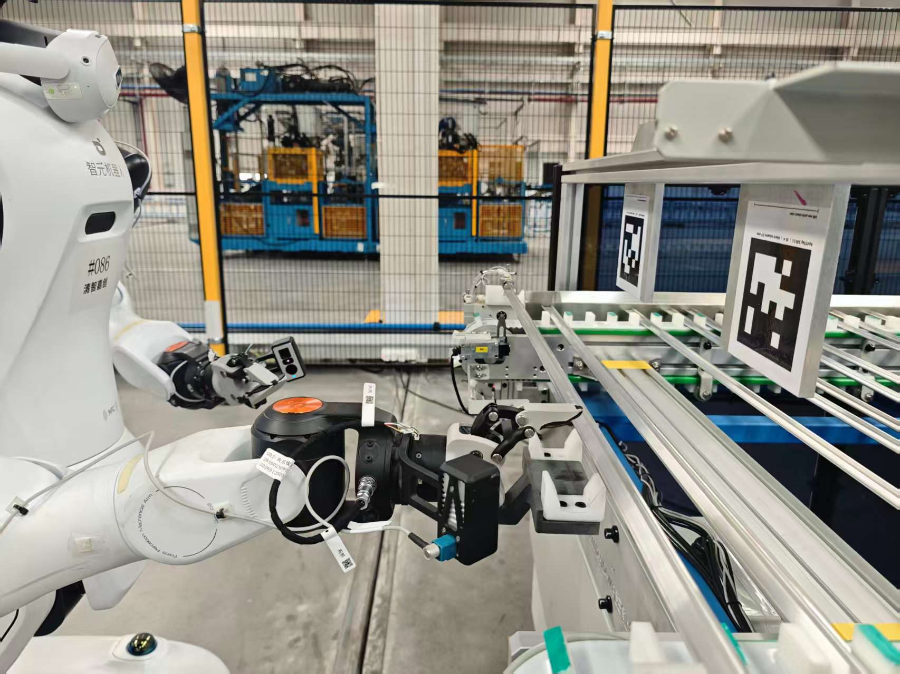
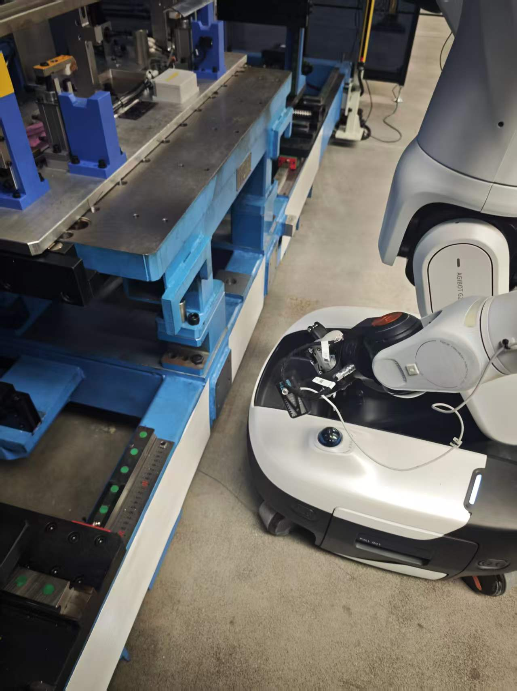
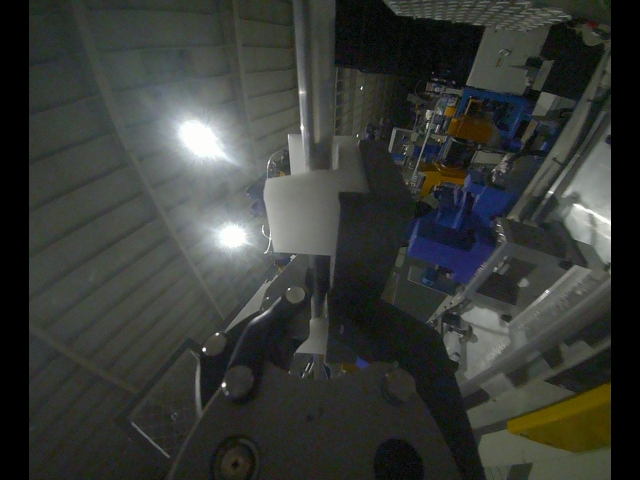
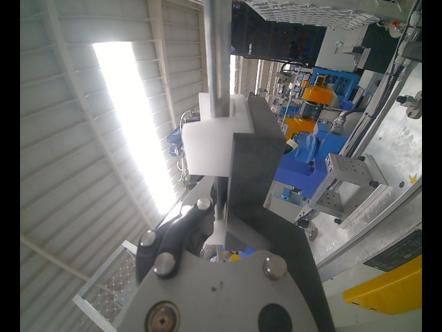
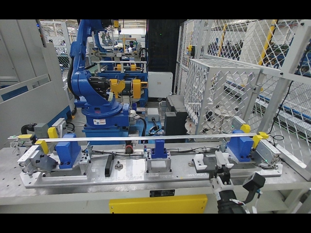
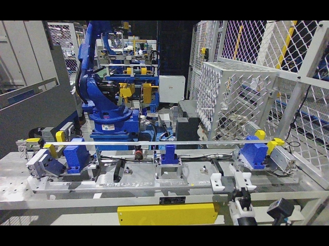
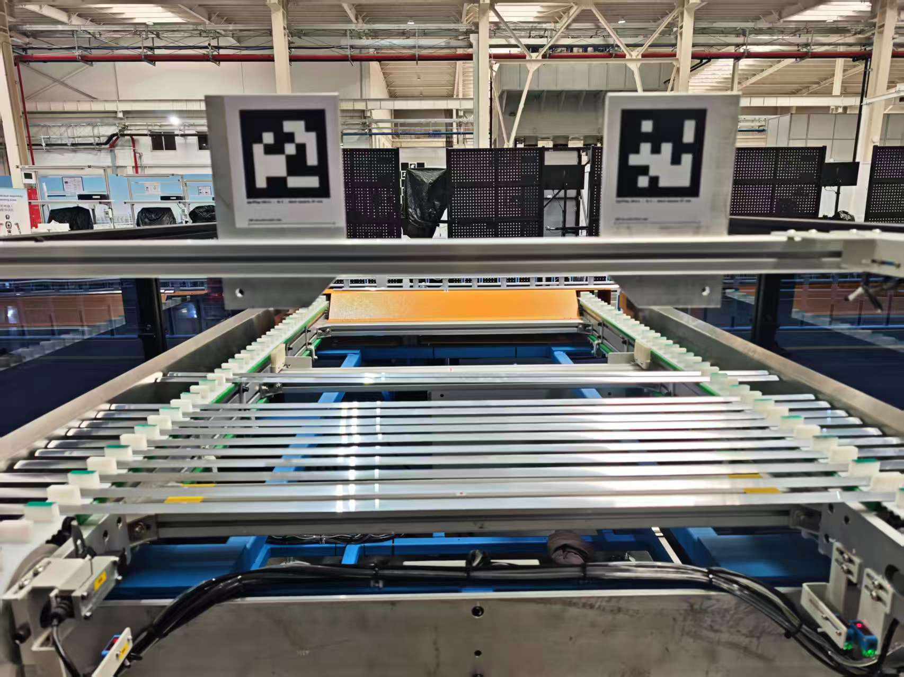
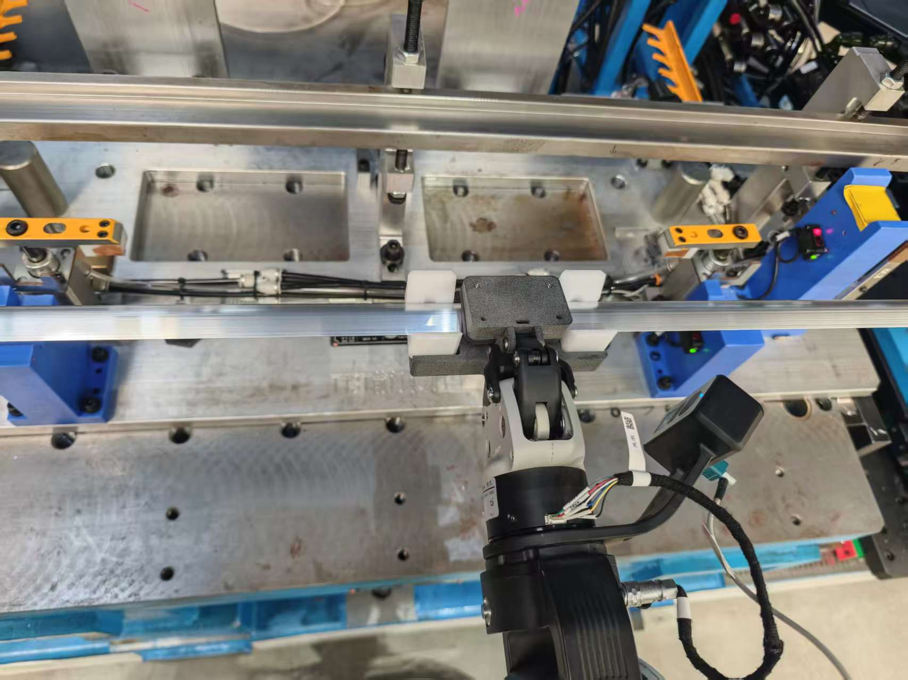

# 目标: 生成4页以上的PPT

# 问题1.泛化性不足：

## 问题现象
固定位置采集500条数据，机器人在固定位置推理，手动放置夹取位置，推理成功率约90%；
但由前一个工位抓取铝条后再移动到推理工位时，推理成功率约60%。

## 原因分析
- 机器人抓取位置不一致

- 盘移动的位置精度不够

- 光照的条件变化差异大（头部相机的光线不太明显，但手部相机的光线差距比较大）

- 全部采集的是正确的放置轨迹数据，没有纠偏数据提供给机器人学习

## 解决方案

1. 对机器人抓取位置进行纠偏，利用二维码纠偏，尽可能固定抓取位置一致

2. 增大采集的数据中底盘的位置变化，每采100条数据就移动一次底盘，而非固定位置采集500条
3. 采集尽可能光亮的场景，避免黑暗灯光下的场景数据，分别在上午采集300条数据，下午采集300条数据，晚上不采集。
4. 在机器人放置轨迹中加入一些错误的纠错程序，在500条数据中加入了20-30左右的纠偏数据，学会首次放错再纠正的能力。

## 试验证
1. 纠偏后机器人的抓料位置偏差很小，肉眼观察几乎在同一个位置

2. 底盘移动的位置无法确定精度
3. 数据集中均为光亮的照片，图片质量高。
4. 在推理过程中，出现过模型尝试放置放偏并自主纠正的过程，但同时存在有的情况机器人会持续纠偏不松手

## 验证效果
1. 机器人抓取的位置固定后，成功率得到明显改善，大约70%
2. 单独改变底盘移动的变量对成功率并没有太大的帮助
3. 光照条件和工装夹具的改变，整体成功率提升到80%
4. 部分情况可以进行纠偏，但会存在不可控的预测情况，成功率约75%

## 问题请教
1. 根据模型的官方介绍，Dagger的方案可以有效提高推理的泛化性，但是具体的纠偏数据应该怎么处理？怎么标注？怎么训练，才能实现较好的纠偏效果