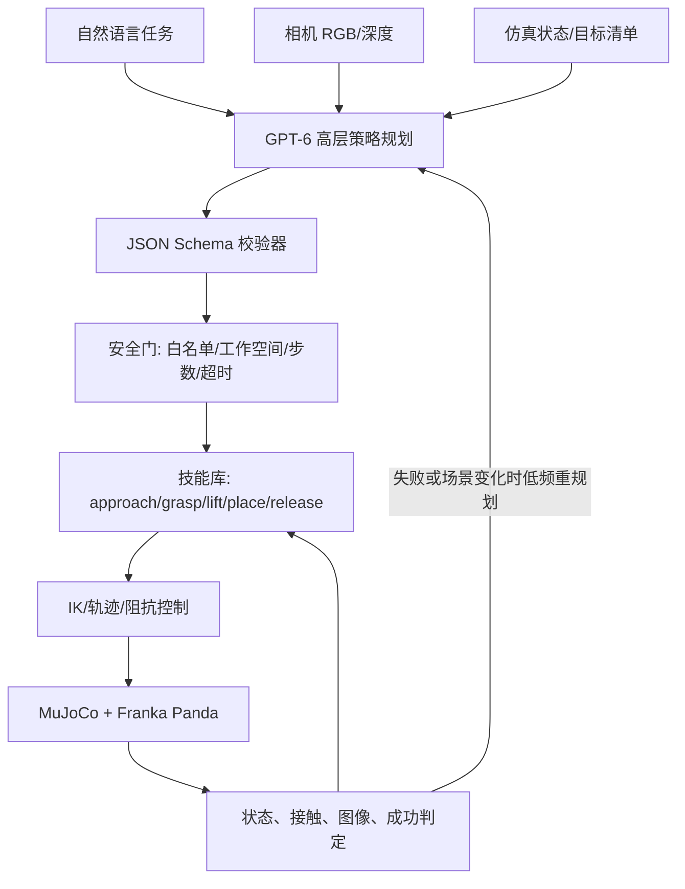

# LLM/VLM 驱动具身智能应用调查：从语言规划到机械臂抓取

> 更新时间：2026 年 10 月 10 日  
> 范围：LLM、VLM、VLA、世界动作模型（WAM）与 Agentic Robotics；重点讨论 MuJoCo + Franka Panda 抓取放置。

## 摘要

LLM/VLM 在机器人中的合适角色不是替代伺服控制器，而是把开放词汇指令与视觉场景转换成受约束、可验证的技能序列。一个可工程化的系统通常分为四层：VLM 完成语义感知，LLM 完成任务分解与失败恢复，技能库完成抓取/放置等闭环动作，MuJoCo、ROS 2 或真机控制器完成高频控制与安全约束。

本文梳理五条主流路线，并给出一套可复现的 GPT-6 + MuJoCo + Franka Panda 示例。示例使用 GPT-6 Astra 的视觉输入和 Structured Outputs 产生有限技能计划；机械臂轨迹仍由确定性状态机执行。这样既利用大模型的开放词汇推理能力，又避免把不稳定的自然语言输出直接发送到关节执行器。

## 1. 技术路线

| 路线 | 输入与输出 | 优点 | 主要限制 | 代表工作 |
|---|---|---|---|---|
| LLM + 技能库 | 指令/状态 → 技能名与参数 | 易解释、易接入已有机器人栈 | 能力上限受技能覆盖率限制 | SayCan、Code as Policies |
| VLM + 3D grounding | 图像/语言 → 目标、约束、价值图 | 支持开放词汇物体与空间关系 | 深度、遮挡和标定误差敏感 | VoxPoser |
| 端到端 VLA | 图像/语言/状态 → 动作块 | 数据驱动，减少人工技能设计 | 数据昂贵，跨本体与安全验证困难 | RT-2、OpenVLA、π 系列 |
| 世界模型 / WAM | 状态与候选动作 → 未来状态 | 可在执行前预测后果、做模型预测控制 | 长时域误差累积，接触建模困难 | Dreamer 类方法、视频世界模型 |
| Agentic Robotics | 感知—规划—执行—检查—恢复 | 能处理长程任务和异常 | 延迟、成本、记忆漂移、工具误调用 | 多智能体/工具调用机器人系统 |

这些路线不是互斥的。实际系统常采用“VLM grounding + LLM planner + VLA/技能策略 + 世界模型验证器”的组合。

## 2. 推荐系统架构



关键设计原则：

1. **模型低频、控制器高频**：GPT-6 在任务开始或失败时规划；100–1000 Hz 的控制回路不依赖云模型。
2. **有限动作空间**：模型只能选择经过测试的技能和有界参数，不生成任意 Python 并立即执行。
3. **状态与图像并用**：仿真可提供精确位姿，RGB 用于验证语义；真机则由检测/分割/位姿估计模块产生结构化状态。
4. **执行后验证**：每个技能都有前置条件、完成条件、超时和恢复动作。
5. **安全独立于模型**：关节限位、速度/力限制、碰撞检测和急停由确定性系统负责。

## 3. LLM、VLM、VLA 与 WAM 的分工

### 3.1 LLM：任务规划与恢复

LLM 擅长把“把桌上的物体放进目标区”分解成 `approach → grasp → lift → move → release`，也适合根据失败原因选择重试、换抓取点或终止。Code as Policies 表明，语言模型可以组合机器人 API 形成策略程序；但生成代码的权限必须沙箱化，生产系统更适合调用白名单技能。

### 3.2 VLM：开放词汇语义感知

VLM 可处理“草绿色方块”“离杯子最近的积木”等自然语言指代。它通常不应单独承担毫米级定位：可靠方案是让 VLM 给出目标身份或区域，再由深度相机、分割模型、6D 位姿估计或仿真真值给出坐标。VoxPoser 展示了将语言知识转为可组合三维价值图，再由运动规划器执行的思路。

### 3.3 VLA：从多模态观测到动作

VLA 将视觉、语言和本体状态直接映射为离散或连续动作，适合高数据量、任务分布较稳定的场景。其难点包括跨机器人动作表示、数据混合、长时域误差、闭环频率和安全认证。工程上可让 VLA 实现某个技能，大模型只负责技能编排。

### 3.4 WAM：预测动作后果

WAM 可评估“从左侧抓”与“从上方抓”的未来结果，或用滚动预测选择动作。它对遮挡恢复、非抓取操作和长程规划有潜力，但接触、摩擦和可变形物体仍是误差来源。MuJoCo 可以充当显式世界模型；学习式 WAM 则用于难以精确建模的部分。

### 3.5 Agentic Robotics：闭环编排

Agentic 系统不是简单的多轮对话，而是一个受控状态机：获取观测、提出计划、检查约束、执行、读取反馈、必要时重规划。应记录提示词、模型版本、结构化计划、仿真种子、轨迹和失败原因，以支持复现实验。

## 4. 开源代码与仿真底座选择

### 4.1 推荐底座

- [`cgsorensen/franka_mujoco`](https://github.com/cgsorensen/franka_mujoco)：提供 `FrankaPush`、`FrankaSlide` 和 `FrankaPickAndPlace` 三个 Gymnasium 多目标环境，并包含强化学习示例。本文示例以其观测/动作接口为基础。
- [`google-deepmind/mujoco_menagerie`](https://github.com/google-deepmind/mujoco_menagerie)：高质量 MuJoCo 机器人模型集合，Franka Panda 模型为 Apache-2.0 许可。
- [`ARISE-Initiative/robosuite`](https://github.com/ARISE-Initiative/robosuite)：基于 MuJoCo 的模块化操作学习框架，适合多任务、传感器和控制器实验。
- [`google-research/google-research/tree/master/code_as_policies`](https://github.com/google-research/google-research/tree/master/code_as_policies)：语言模型组合机器人 API 的代表性实现，可参考其提示设计和策略生成方式。
- [`huangwl18/VoxPoser`](https://github.com/huangwl18/VoxPoser)：VLM/LLM 与三维价值图结合的语言条件操作框架。

选择 `franka_mujoco` 的原因是依赖较轻、任务接口清晰且已经包含 Panda pick-and-place；选择 robosuite 的理由则是环境和控制器更丰富。若目标是 ROS 2/Gazebo 到真机迁移，可将同一 GPT-6 planner 接到 MoveIt 2 action/service，而不改变规划输出 schema。

### 4.2 本仓库可运行示例

代码位于 [`examples/gpt6_franka_mujoco`](examples/gpt6_franka_mujoco/README.md)，包含：

- `planner.py`：将任务、结构化场景状态和可选 RGB 图像发送给 GPT-6 Astra；以 Pydantic schema 返回有限技能计划。
- `controller.py`：把技能序列展开为末端执行器增量动作，并进行参数限幅与超时控制。
- `run.py`：创建 `FrankaPickAndPlaceSparse-v0` 环境，执行计划并报告是否成功。
- `test_controller.py`：无需 MuJoCo/API 的单元测试。

示例中的 GPT-6 是**策略推理器**，不是连续控制器。OpenAI 官方文档当前建议新项目使用 `gpt-6-astra`；Responses API 支持图像输入，Structured Outputs 可让输出符合给定 schema。账户是否具有该模型权限仍取决于实际 API 项目。

## 5. 例子：GPT-6 规划抓取放置

核心调用如下，完整实现见 `planner.py`：

```python
response = client.responses.parse(
    model="gpt-6-astra",
    input=[
        {"role": "system", "content": SYSTEM_PROMPT},
        {"role": "user", "content": content},
    ],
    text_format=RobotPlan,
)
plan = response.output_parsed
```

返回的计划只能包含：

```json
{
  "summary": "pick the object and place it at the goal",
  "steps": [
    {"skill": "approach_object", "target": "object", "height_m": 0.08},
    {"skill": "descend", "target": "object", "height_m": 0.01},
    {"skill": "close_gripper", "target": "object", "height_m": 0.00},
    {"skill": "lift", "target": "object", "height_m": 0.10},
    {"skill": "move_above_goal", "target": "goal", "height_m": 0.10},
    {"skill": "descend", "target": "goal", "height_m": 0.02},
    {"skill": "open_gripper", "target": "goal", "height_m": 0.00}
  ]
}
```

执行器会拒绝未知技能、过多步骤、越界高度与非有限数值。生产版本还应加入可达性检查、碰撞规划、接触力阈值和人工急停。

## 6. 实验设计与评价

建议至少报告以下指标：

| 维度 | 指标 |
|---|---|
| 任务结果 | 抓取成功率、放置成功率、平均重试次数 |
| 几何精度 | 最终物体—目标距离、姿态误差、碰撞次数 |
| 效率 | 完成时间、控制步数、LLM 调用次数、token 与费用 |
| 泛化 | 新颜色/新物体/新指令/新位置的成功率 |
| 鲁棒性 | 遮挡、光照、摩擦、质量、相机噪声扰动下性能 |
| 安全 | 越界计划拒绝率、错误动作拦截率、最大接触力 |

应设置至少四组消融：规则规划器；LLM 仅文本状态；VLM 图像 + 状态；带失败重规划的 Agentic 版本。固定 MuJoCo seed，并保存每次模型返回的结构化计划。由于云端模型可能更新，论文实验还应记录精确模型 ID、日期和提示词版本。

## 7. 从仿真到真实机械臂

1. 用域随机化覆盖相机外参、光照、纹理、质量、摩擦和执行延迟。
2. 将仿真真值替换为检测、深度和 6D 位姿估计，同时保持同一 `SceneState` 接口。
3. 将增量控制器替换为 MoveIt 2、libfranka 或厂商控制器；保持 planner 的有限技能接口不变。
4. 在独立安全进程中限制工作空间、速度、力矩和碰撞；任何通信超时都进入安全状态。
5. 先做影子模式和软物体/低速测试，再逐步提高速度与任务复杂度。

## 8. 局限与研究问题

- VLM 的空间判断不等于精确几何测量，必须与深度/位姿系统融合。
- LLM 计划具有非确定性；schema 只能保证格式，不能保证物理可行性。
- API 延迟和网络故障使其不适合实时控制环。
- 仿真接触模型、相机模型与真机之间仍存在 sim-to-real gap。
- 端到端 VLA 与模块化技能系统之间并非简单替代关系；数据规模、任务开放度和认证要求决定架构。
- 未来值得研究：动作 token 统一、长程记忆、世界模型验证、触觉 VLA、多机器人协作和可形式化验证的 agent。

## 参考资料

1. OpenAI, [Structured model outputs](https://developers.openai.com/api/docs/guides/structured-outputs?api-mode=responses).
2. OpenAI, [Images and vision](https://developers.openai.com/api/docs/guides/images-vision).
3. Google DeepMind, [MuJoCo Menagerie](https://github.com/google-deepmind/mujoco_menagerie).
4. Xu et al., [Open-Source Reinforcement Learning Environments Implemented in MuJoCo with Franka Manipulator](https://arxiv.org/abs/2312.13788), 2023.
5. Zhu et al., [robosuite: A Modular Simulation Framework and Benchmark for Robot Learning](https://arxiv.org/abs/2009.12293), 2020.
6. Liang et al., [Code as Policies: Language Model Programs for Embodied Control](https://arxiv.org/abs/2209.07753), 2022.
7. Huang et al., [VoxPoser: Composable 3D Value Maps for Robotic Manipulation with Language Models](https://arxiv.org/abs/2307.05973), 2023.

