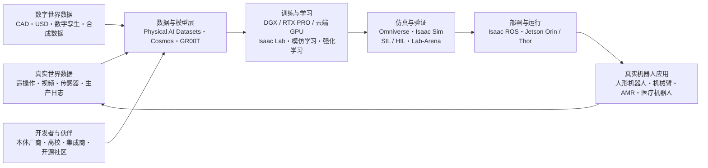

# 英伟达在具身智能应用领域的生态环境建设

> 更新时间：2026 年 10 月 10 日  
> 说明：本文所称“具身智能”主要指机器人、自动驾驶设备及其他能够感知物理环境、进行推理并执行动作的 Physical AI（物理 AI）系统。内容以英伟达公开资料为基础，重点讨论机器人与工业应用。

## 一、概述

英伟达在具身智能领域并不只提供 GPU 或单一机器人模型，而是在建设一套覆盖“数据采集—数据生成—模型训练—仿真验证—边缘推理—真实部署—持续迭代”的平台型生态。

其核心思路可以概括为“三台计算机、一个软件栈、一张合作网络”：

- **训练计算机**：以 DGX、RTX PRO、DGX Cloud 等基础设施训练机器人基础模型和任务策略。
- **仿真计算机**：以 Omniverse、OVX、Isaac Sim 和 Isaac Lab 构建数字孪生、生成合成数据，并完成软件在环或硬件在环测试。
- **机器人计算机**：以 Jetson Orin、Jetson Thor 等边缘平台在机器人端完成实时感知、推理与控制。
- **统一软件栈**：以 CUDA 为底层，向上连接 Omniverse、Cosmos、Isaac、GR00T、Isaac ROS 和相关部署工具。
- **产业合作网络**：连接机器人本体厂商、工业机器人厂商、传感器与执行器供应商、云厂商、系统集成商、研究机构、开源社区和最终用户。

因此，英伟达的生态定位更接近“具身智能时代的通用计算与开发基础设施提供者”，而不是亲自制造并销售某一种机器人本体。

## 二、生态总体架构



这一架构的关键不只是产品数量，而是形成闭环：真实运行产生的数据可以重新进入训练流程；仿真生成的数据可缓解真机采集成本和安全风险；同一套 GPU/CUDA 架构则尽量减少从数据中心到机器人端的迁移成本。

## 三、生态建设的六个核心层次

### 1. 计算基础设施：打通“云—数据中心—工作站—机器人端”

英伟达首先用统一的 GPU 计算架构覆盖具身智能的不同阶段：

| 环节 | 代表平台 | 主要作用 |
|---|---|---|
| 大规模训练 | DGX、DGX Cloud、Blackwell GPU 系统 | 训练与微调 VLA、世界模型、感知模型和控制策略 |
| 仿真与开发 | OVX、RTX PRO 工作站和服务器 | 运行 Omniverse、Isaac Sim、Isaac Lab 及并行仿真 |
| 端侧部署 | Jetson Orin、Jetson Thor | 多传感器处理、低时延推理和机器人实时控制 |
| 软件加速底座 | CUDA、TensorRT、JetPack | 提供训练、模型优化和端侧部署的一致工具链 |

其中，Jetson Thor 面向人形机器人及复杂 Physical AI 工作负载，重点支持 VLA、视觉语言模型、多传感器融合和实时控制。其战略价值在于将较大的生成式 AI 模型带到机器人端，而非完全依赖云端推理。

### 2. 仿真与数字孪生：建设机器人的“虚拟训练场”

**Omniverse** 是英伟达物理 AI 生态的数字世界底座。它以 OpenUSD 为共同数据语言，连接 CAD、场景资产、物理属性、传感器和不同工程工具，使工厂、仓库、机器人及其作业环境能够在同一数字孪生中组合。

在 Omniverse 之上，英伟达形成了分工明确的机器人仿真工具：

- **Isaac Sim**：用于高保真机器人仿真、传感器仿真、合成数据生成，以及软件在环（SIL）和硬件在环（HIL）测试。
- **Isaac Lab**：面向大规模机器人学习，支持强化学习、模仿学习、运动控制及多种机器人形态。
- **Isaac Lab-Arena**：用于通用机器人策略的标准化、并行化评测，帮助不同模型和任务获得可比较的结果。
- **PhysX、Warp 与 Newton**：为刚体、多关节、接触和其他复杂物理过程提供 GPU 加速的物理计算能力。
- **Mega Omniverse Blueprint**：面向多机器人、多传感器和大型设施的数字孪生测试及优化。

这套体系将仿真从传统工程设计工具，扩展为机器人数据生成、策略训练、测试验证和持续运营的平台。

### 3. 数据体系与世界模型：缓解具身智能的数据瓶颈

具身智能的数据不仅要包含图像或文字，还要同步记录状态、动作、力、触觉、轨迹和环境变化，真机采集成本高且长尾场景难以覆盖。英伟达围绕这一问题建设了多条数据通道：

- **Isaac TeleOp**：通过真实或仿真遥操作采集高质量示范数据。
- **Isaac GR00T-Mimic**：扩增少量人类示范，生成更多可用于操作任务训练的轨迹。
- **Isaac GR00T-Dreams**：利用生成式 AI 和世界模型扩大机器人运动及任务数据。
- **Omniverse Replicator / Isaac Sim**：通过域随机化和场景变化生成带标注的合成感知数据。
- **Cosmos 世界基础模型**：用于生成、理解和推演物理世界的视频及状态变化，支撑数据增强、世界预测与策略训练。
- **NVIDIA Physical AI Open Datasets**：向开发者开放经过整理的数据集，降低训练与评测门槛。

这些工具共同构成“真实数据 + 仿真数据 + 生成数据”的数据飞轮。它不能自动消除仿真到真实的差距，但能显著提高数据覆盖率和实验迭代速度。

### 4. 模型体系：从专用模型走向通用机器人基础模型

英伟达的模型层同时包含通用机器人模型和可复用的专用能力：

- **Isaac GR00T N 系列**：面向人形机器人及通用操作任务的开放、可定制机器人基础模型，重点连接视觉、语言、推理和动作输出。
- **感知模型与算法**：如 FoundationPose 等，用于新物体的 6D 位姿估计与跟踪。
- **操作与运动能力**：如 cuMotion，用 GPU 并行优化运动轨迹；Isaac Manipulator 提供机械臂感知与操作参考工作流。
- **导航与移动能力**：通过 Isaac ROS 的感知、定位、建图、导航组件服务于 AMR 和移动操作机器人。

GR00T 的生态意义不是替代所有控制器，而是在高层任务理解与通用技能学习上提供基础模型，再与本体专属的小脑控制、规划器、安全系统和实时控制器结合。

### 5. 中间件和工程化：连接 AI 模型与真实机器人

**Isaac ROS** 是英伟达连接算法与物理设备的重要桥梁。它构建在 ROS 2 生态之上，提供 GPU 加速的感知、图像处理、位姿估计、导航和运动规划软件包。

其关键价值包括：

- 兼容既有 ROS 2 节点，降低机器人企业接入门槛；
- 通过 NITROS 减少机器人数据管线中的不必要复制，提高吞吐与资源利用率；
- 将在工作站或数据中心训练好的模型部署到 Jetson 平台；
- 用模块化 GEM 软件包复用感知与规划能力，减少重复开发；
- 通过 Isaac Sim 与 ROS 2 Bridge 支持虚实联调。

此外，OSMO 等编排工具用于管理从本地到公有云的分布式训练、仿真和数据处理任务，使具身开发逐渐具备类似 MLOps 的规模化工程能力。

### 6. 开放标准、开发者和产业伙伴：扩大平台网络效应

英伟达通过多种方式降低生态参与门槛：

- 采用并推动 **OpenUSD、ROS 2、URDF、MJCF** 等开放格式或接口，连接现有机器人和三维工程工具链；
- 将 Isaac Lab、部分 Isaac/GR00T 模型、数据及物理引擎以开放方式提供；
- 与 Hugging Face LeRobot 等开源社区集成，支持模型微调、评测和跨本体使用；
- 通过开发者论坛、文档、示例、线上课程、DLI 培训和 Office Hours 培养开发者；
- 通过 **NVIDIA Inception** 为初创企业提供技术、培训、云资源、硬件优惠、市场和融资网络支持；
- 与机器人本体厂商、工业自动化企业、云服务商、系统集成商、高校及研究机构共同建设参考工作流和应用案例。

截至公开资料所示，其合作网络已覆盖 ABB Robotics、FANUC、KUKA、Yaskawa、Universal Robots 等工业机器人企业，以及 Boston Dynamics、Agility Robotics、Figure、1X、NEURA Robotics、AGIBOT 等人形机器人或通用机器人开发者。参与者使用的并不一定是完整英伟达栈，也可能只采用其中的计算平台、仿真工具或模型组件。

## 四、英伟达如何形成生态闭环

英伟达生态的网络效应可以概括为：

1. 更多本体和传感器厂商适配 Jetson、Isaac 与 OpenUSD，扩大可直接使用的硬件和资产范围。
2. 更多开发者使用统一工具链，带来更多教程、模型、数据集和集成经验。
3. 更多真实应用产生新的失败案例和高价值数据，推动模型与仿真环境迭代。
4. 模型和仿真能力提升后，开发周期和真机试错成本下降，吸引更多终端企业采用。
5. 应用规模扩大，进一步增加对训练、仿真和边缘计算的需求。

从商业模式看，开放模型、框架和开发资源有助于降低采用门槛；GPU、服务器、云算力、Jetson 模组以及企业软件与支持则承接生态规模扩大后的商业价值。

## 五、重点应用方向

### 工业制造

工业制造是英伟达具身生态最容易形成闭环的场景之一，典型应用包括机械臂上下料、装配、分拣、检测、机床照料、柔性物流和多机器人协同。数字孪生可复用工厂 CAD 数据，仿真可以提前完成节拍、安全和可达性验证，Isaac ROS 与 Jetson 则负责现场感知和推理。

### 人形机器人

人形机器人是 GR00T、Jetson Thor、Isaac Lab 与 Cosmos 的集中落点。英伟达试图提供从遥操作采集、合成动作生成、基础模型微调、仿真评测到端侧推理的完整流水线，让不同本体共享尽可能多的软件、模型和数据基础设施。

### 自主移动机器人与物流

Isaac ROS 的定位、视觉、导航和传感器处理能力，以及 Isaac Sim 的仓储数字孪生和多机器人测试能力，可支持 AMR 在仓库、工厂与配送场景中的开发和部署。

### 医疗与专业机器人

英伟达还通过 Isaac for Healthcare、Holoscan 与 Jetson 等平台进入手术机器人、医疗设备和高吞吐传感器处理场景。这类应用对时延、可靠性、安全验证和监管合规的要求更高，也能体现软硬件一体化平台的价值。

## 六、对工业企业的实际价值

对于希望导入具身智能的制造企业，英伟达生态主要带来四类价值：

- **缩短开发链路**：训练、仿真、测试、部署采用相互衔接的工具，减少多套系统间的转换工作。
- **减少真机试错**：在数字孪生中测试危险、稀有或节拍敏感的场景，再转移到真实设备。
- **提高数据利用率**：将少量遥操作数据与模仿学习、域随机化、合成数据和世界模型结合。
- **支持异构本体**：通过 ROS 2、OpenUSD 和模块化模型，把同一方法迁移到机械臂、AMR、人形机器人等不同设备。

一条较典型的工业落地路径是：

```text
场景筛选 → CAD/设备建模 → 真机遥操作采集 → 数据清洗与格式统一
→ 基础模型微调 → Isaac Lab/Isaac Sim 仿真评测 → Jetson 端部署
→ 现场小批量验证 → 失败数据回流 → 再训练与规模化复制
```

## 七、生态建设面临的挑战

英伟达的平台能力较完整，但生态落地仍存在若干现实限制：

1. **仿真到真实仍有差距**：接触、柔性材料、摩擦、触觉和复杂装配的建模精度仍会影响策略迁移。
2. **数据标准尚未完全统一**：不同机器人本体、传感器、控制频率和数据格式会增加数据复用成本。
3. **实时控制不能只靠大模型**：工业设备仍需确定性的控制器、安全回路、碰撞保护和故障处理机制。
4. **全栈投入较高**：高保真资产制作、大规模仿真、GPU 训练和现场系统集成都需要专业团队与算力投入。
5. **平台依赖风险**：企业采用完整英伟达栈后，应评估软硬件绑定、版本兼容、许可证、供应链与总体拥有成本。
6. **量产评价标准仍在形成**：实验演示、单任务成功率与可长期运行的工业系统之间仍有明显距离，需要关注节拍、可恢复性、安全性和维护成本。

## 八、结论

英伟达在具身智能领域的核心竞争力，是用统一加速计算架构将模型、数据、仿真、中间件和端侧硬件连成闭环，并通过开放接口与广泛合作伙伴把这套能力扩展到多种机器人本体和行业。

其生态建设可归纳为三点：

1. **以算力为底座**：覆盖训练、仿真和机器人端推理。
2. **以仿真和数据飞轮为核心**：通过 Omniverse、Isaac 与 Cosmos 提高机器人学习和验证效率。
3. **以开放工具和产业合作扩大网络效应**：让本体厂商、开发者、集成商和终端企业在同一平台上共同创新。

对工业企业而言，最值得关注的并非是否一次性采用全部产品，而是选择能够解决当前瓶颈的模块：例如用 Isaac Sim 补足仿真验证，用 GR00T 验证通用操作策略，用 Isaac ROS 加速感知与规划，再用 Jetson 完成端侧部署。按场景逐步构建数据闭环，通常比直接追求“大而全”的机器人平台更具可执行性。

## 参考资料

以下资料均来自英伟达官方页面，访问日期为 2026 年 10 月 10 日：

1. [NVIDIA Isaac：AI 机器人开发平台](https://developer.nvidia.com/isaac)
2. [NVIDIA Isaac Sim：机器人仿真与合成数据生成](https://developer.nvidia.com/isaac/sim)
3. [NVIDIA Isaac Lab：GPU 加速机器人学习框架](https://developer.nvidia.com/isaac/lab)
4. [NVIDIA Isaac Lab-Arena：机器人策略评测框架](https://developer.nvidia.com/isaac/lab-arena)
5. [NVIDIA Isaac ROS](https://developer.nvidia.com/isaac/ros)
6. [NVIDIA Omniverse 与 Physical AI](https://perspectives.nvidia.com/physical-ai/omniverse/)
7. [NVIDIA Jetson Thor](https://www.nvidia.com/en-us/autonomous-machines/embedded-systems/jetson-thor/)
8. [NVIDIA Inception 初创企业计划](https://www.nvidia.com/en-us/startups/)
9. [NVIDIA 发布 Isaac GR00T N1 及机器人仿真框架](https://nvidianews.nvidia.com/news/nvidia-isaac-gr00t-n1-open-humanoid-robot-foundation-model-simulation-frameworks)
10. [NVIDIA 以云到机器人平台推动人形机器人产业](https://nvidianews.nvidia.com/news/nvidia-powers-humanoid-robot-industry-with-cloud-to-robot-computing-platforms-for-physical-ai)
11. [NVIDIA 发布 Physical AI 模型并扩展全球机器人合作生态](https://nvidianews.nvidia.com/news/nvidia-releases-new-physical-ai-models-as-global-partners-unveil-next-generation-robots)
12. [NVIDIA 与全球机器人企业推动 Physical AI 规模化落地](https://nvidianews.nvidia.com/news/nvidia-and-global-robotics-leaders-take-physical-ai-to-the-real-world)

